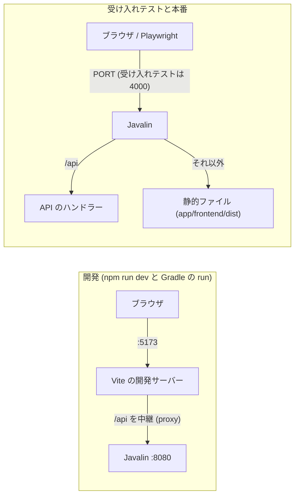
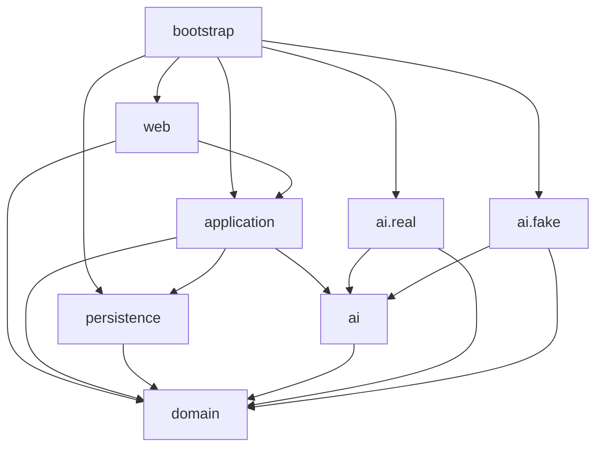

# 全体の構成

アプリケーション全体の構成を、機能をまたいで 1 つの文書に書く。機能ごとの設計は、`docs/features/<機能>/architecture.md` に書く。API の契約は [`docs/api/openapi.yaml`](api/openapi.yaml) に書く。

- 現在の機能: [ai-student-lesson (AI 生徒育成型・対話学習サービスの MVP)](features/1-ai-student-lesson/architecture.md)
- 前提: [`docs/project.md`](project.md) の方針 (優先順位は D (納期) > C (費用) > Q (品質)、品質の水準は MVP)。利用者は数十人から 100 人規模。

## 1. 技術スタック

既定の技術スタックをそのまま使う。既定から外れるものは、「1.3 既定に足すもの」に理由を書く。

### 1.1 フロントエンド

| 用途 | 選択 |
| --- | --- |
| 言語 | TypeScript |
| UI | React、React Router、Tailwind CSS、Radix UI (Primitives) |
| ビルド | Vite |
| テスト | Vitest (単体)、dependency-cruiser (依存の向き) |
| Lint と整形 | Oxc (oxfmt と oxlint) |
| デプロイ | Cloud Run (バックエンドと同じコンテナ。2.2 参照) |

Playwright は、`app/` の外の `acceptance/` にある (3 節)。

### 1.2 バックエンド

| 用途 | 選択 |
| --- | --- |
| 言語 | Java 21 (JDK 21) |
| Web | Javalin |
| DB | PostgreSQL |
| DB アクセス | jOOQ |
| ビルド | Gradle |
| テスト | JUnit、Testcontainers (PostgreSQL)、ArchUnit |
| 整形 | Spotless |
| デプロイ | Cloud Run |

共通: Docker、Node.js LTS (npm)、JDK 21。

### 1.3 既定に足すもの

既定に無いライブラリを足すときは、プロジェクトの方針 (納期優先、MVP) に合うものだけにする。

| 足すもの | 用途 | 理由 |
| --- | --- | --- |
| tldraw | ホワイトボード | `docs/project.md` の必須技術 |
| Live2D (Cubism SDK for Web と pixi-live2d-display 系の描画ライブラリ) | AI 生徒と先輩先生の描画 | `docs/project.md` の必須技術 |
| ElevenLabs | 音声合成 (TTS) と音声認識 (STT) | TTS は `docs/project.md` の必須技術。STT も同じ事業者の API にそろえると、秘密情報と契約が 1 つで済む |
| マルチモーダル LLM の API | 教材の整理、応答、評価、まとめ、模試、丸つけ | `docs/project.md` の外部サービス。事業者は、バックエンドの `ai` ポート (`docs/features/1-ai-student-lesson/architecture.md` の 4.3) の裏に隠す。初期の実装は OpenAI の API とする (費用の見積もりが Codex の API 利用料であるため) |
| Flyway | DB のスキーマの移行 | jOOQ のコード生成と、Cloud Run での起動時の移行に、順序付きの SQL が要るため。ORM の既定には移行の仕組みが含まれない |
| Jackson | JSON の読み書き (バックエンド) | Javalin が標準で使う |
| TanStack Query | サーバーの状態の取得とポーリング (フロントエンド) | 教材の整理の結果を、整理中の間ポーリングするため。自前の実装を避けて納期を守る |
| openapi-typescript | `docs/api/openapi.yaml` から API の型を生成する (フロントエンド) | 契約と実装のずれを、型で検出するため |
| html-to-image | 画面の内容を PNG にする (フロントエンド) | 画像の保存は、サーバーを経由せずにクライアントだけで行う (NFR-304 の共有の範囲を守るため) |

Radix UI の部品は、確認のダイアログ (AlertDialog)、チェックボックス (Checkbox)、生徒の選択 (RadioGroup) に使う。

## 2. 使い方の選択

### 2.1 React Router は SPA として使う

React Router は、フレームワークのモードではなく、ライブラリのモード (`createBrowserRouter`) の SPA として使う。

- 理由: SEO も、サーバー側の描画も要らない。画面は、ログイン後の対話 UI だけである。ビルドの結果が静的ファイルだけになり、バックエンドから配信できる (2.2)。フレームワークのモードは、Node.js のサーバーをもう 1 つ増やし、納期と費用の方針に合わない。
- 画面の URL は、受け入れテストを書く段階で決める。アプリケーションは、未知のパス (`/api` 以外) に `index.html` を返す (SPA のフォールバック)。

### 2.2 画面と API を 1 つのオリジンで提供する

受け入れテストは、1 つのオリジンに向けて実行する。次のとおり、場面ごとにまとめ方を変える。



| 場面 | まとめ方 |
| --- | --- |
| 開発 | Vite の開発サーバー (5173) が、`/api` をバックエンド (8080) へ中継する。ブラウザは 5173 だけを見る。バックエンドは、`AI_MODE` を指定しなければ `fake` で起動する (外部 AI の秘密情報なしで画面を触れる) |
| 受け入れテスト | `scripts/start-app.sh` が、フロントエンドをビルドし、バックエンドを `PORT=4000`、`AI_MODE=fake`、`STATIC_DIR=app/frontend/dist` で起動する。バックエンドが `/api` と静的ファイルを同じポートで返す。本番と同じ形なので、開発サーバーの中継には頼らない |
| 本番 | 1 つのコンテナ (Cloud Run のサービス 1 つ) に、バックエンドとビルド済みのフロントエンドを入れる。バックエンドが `/api` と静的ファイルを返す。Web サーバーや CDN は置かない |

環境変数で、バックエンドの起動を決める。

| 変数 | 意味 | 既定 |
| --- | --- | --- |
| `PORT` | 待ち受けるポート | 8080 |
| `DATABASE_URL`、`DATABASE_USER`、`DATABASE_PASSWORD` | PostgreSQL への接続 | (必須) |
| `STATIC_DIR` | 静的ファイルのディレクトリ。未指定なら静的ファイルを配信しない (開発) | 未指定 |
| `AI_MODE` | `real` か `fake`。`fake` のとき、外部 AI をフェイクに差し替え、テスト用の API (`/api/test/*`) を有効にする | `fake` (`ENV=production` のときは `real` に固定し、`fake` を指定すると起動に失敗する) |
| `LLM_API_KEY`、`LLM_MODEL_ORGANIZE`、`LLM_MODEL_DIALOGUE` | LLM の秘密情報とモデル名。`real` のとき必須 | なし |
| `ELEVENLABS_API_KEY`、`ELEVENLABS_VOICE_IDS`、`ELEVENLABS_TTS_MODEL`、`ELEVENLABS_STT_MODEL` | ElevenLabs の秘密情報と設定。`real` のとき必須 | なし |

## 3. `app/` の中の分け方

アプリケーションのコードは、すべて `app/` の下に置く。小さいうちは、フロントエンドとバックエンドの 2 つに分ける。機能が増えて 1 つのディレクトリが重くなったら、機能ごとのモジュールに分ける。

```text
app/
├── frontend/            # React の SPA (Vite)
│   └── src/
│       ├── main.tsx
│       ├── app/         # ルーターの組み立て (routes.tsx)
│       ├── pages/       # 画面。1 つの URL に 1 つ
│       ├── features/    # 機能ごとの部品とフック (setup、home、materials、consultation、lesson、mock-exam、records)
│       ├── shared/      # 機能をまたぐ部品
│       │   ├── ui/      # Radix と Tailwind の共通部品
│       │   ├── board/   # tldraw のラッパー、ペンの状態の追跡
│       │   ├── avatar/  # Live2D のラッパー
│       │   ├── audio/   # 録音と再生
│       │   ├── image-export/  # PNG の書き出しと共有
│       │   └── lib/     # 日付、整形などの純粋な関数
│       └── api/         # API のクライアントと、openapi-typescript が生成した型
├── backend/             # Javalin (Gradle)
│   └── src/
│       ├── main/java/com/teachme/
│       │   ├── domain/        # 業務の規則 (純粋な Java)
│       │   ├── ai/            # 外部 AI のポート (インターフェースと入出力の型)
│       │   │   ├── real/      # 実際の外部 AI の実装
│       │   │   └── fake/      # テスト用のフェイク
│       │   ├── persistence/   # jOOQ を使うリポジトリ (生成物は persistence/generated)
│       │   ├── application/   # ユースケース
│       │   ├── web/           # Javalin のルート、DTO、エラーの変換
│       │   └── bootstrap/     # 起動と、部品の組み立て
│       ├── main/resources/db/migration/   # Flyway の SQL
│       └── test/java/         # JUnit、Testcontainers、ArchUnit
└── Dockerfile           # 本番のイメージ (フロントエンドのビルド → バックエンド → 実行)
```

受け入れテストは、`app/` の外の `acceptance/` に、Playwright で置く (実装タスクで書く)。`app/` の中に置くテストは、単体テストだけにする。

テストの置き方:

- フロントエンドの単体テストは、対象のファイルの隣に `*.test.ts` か `*.test.tsx` で置く (Vitest)。
- バックエンドの単体テストと、Testcontainers を使う DB の統合テストは、`app/backend/src/test/java/` に置く。ArchUnit のテストも同じ場所に置く。
- jOOQ のコードは、migration を適用した PostgreSQL に対して生成し、生成物を git に入れる (ビルドのたびに Docker を要さないようにするため)。再生成は、Gradle のタスクで、Testcontainers の PostgreSQL に対して行う。

## 4. モジュール間の依存の向き

後の段階で、ArchUnit (Java) と dependency-cruiser (TypeScript) のルールに書き起こす。「依存してよい」のは、ここに書いたものだけである。書いていない向きは禁止とする。

### 4.1 バックエンド (パッケージは `com.teachme` の下)



| パッケージ | 依存してよいもの | 依存してはいけないもの |
| --- | --- | --- |
| `domain` | JDK だけ | すべての他のパッケージ。Javalin、jOOQ、Jackson (アノテーションを含む)、HTTP クライアントも使わない |
| `ai` (ポート) | `domain`、JDK | `ai.real`、`ai.fake`、`persistence`、`application`、`web` |
| `ai.real` | `ai`、`domain`、JDK、HTTP クライアント、Jackson | `ai.fake`、`persistence`、`application`、`web` |
| `ai.fake` | `ai`、`domain`、JDK | `ai.real`、`persistence`、`application`、`web`。ネットワークへ出ない |
| `persistence` | `domain`、jOOQ、JDBC | `ai`、`application`、`web`、Javalin |
| `application` | `domain`、`ai`、`persistence` | `web`、`ai.real`、`ai.fake`、`bootstrap`、Javalin |
| `web` | `application`、`domain`、Javalin、Jackson | `persistence`、`ai`、`ai.real`、`ai.fake`、`bootstrap`、jOOQ |
| `bootstrap` | すべて | (なし)。ほかのパッケージから `bootstrap` に依存してはいけない |

追加の規則:

- `ai.real` と `ai.fake` を知るのは、`bootstrap` だけとする。`AI_MODE` で、どちらを組み立てるかを `bootstrap` が決める。
- jOOQ の型 (`org.jooq..`) を使うのは、`persistence` だけとする。Javalin の型 (`io.javalin..`) を使うのは、`web` と `bootstrap` だけとする。
- パッケージの循環を作らない。
- `application` のクラスは、時刻を `java.time.Clock` で受け取る (日本時間の週と日付の計算と、テストのため)。`Instant.now()` などを直接呼ばない。

### 4.2 フロントエンド (`app/frontend/src` の下)

| ディレクトリ | 依存してよいもの | 依存してはいけないもの |
| --- | --- | --- |
| `app` | `pages`、`shared`、`api` | `features` を直接 |
| `pages` | `features`、`shared`、`api` | `app`、`pages` どうし |
| `features/<名前>` | 自分の `features/<名前>` の中、`shared`、`api` | ほかの `features/<別の名前>`、`pages`、`app` |
| `shared/ui`、`shared/board`、`shared/avatar`、`shared/audio`、`shared/image-export` | 自分のディレクトリの中、`shared/lib` | ほかの `shared/*` (`lib` を除く)、`features`、`pages`、`app`、`api` |
| `shared/lib` | 自分のディレクトリの中 | `shared` のほかのディレクトリ、`features`、`pages`、`app`、`api` |
| `api` | 自分のディレクトリの中 | `shared`、`features`、`pages`、`app` |

追加の規則:

- 循環する依存を作らない。
- `src` のファイルから、`*.test.ts(x)` を import しない。
- `features` が `features` に依存したくなったら、共通の部分を `shared` に移す。
- 画面や API を外から確かめる受け入れテストは、`app/` の中に置かない (`acceptance/` に置く)。

## 5. 横断の決まり

- 識別: 利用者は、バックエンドが発行する Cookie `teachme_uid` で識別する。アカウントの登録とログインは無い (仕様書 1.1)。
- 時刻: 日付と週は日本時間 (Asia/Tokyo) で数える。時刻は、サーバーの `Clock` を使う。
- エラー: すべての API が、同じ形 (`{ "error": { "code", "message", "fields?" } }`) で返す。
- 外部 AI: `ai` ポートの裏に置く。バックエンドの外へ出るのは、このポートからの呼び出しだけとする。
- 記録の取り扱い: ログに、利用者の発話、字幕、ボード、画像の中身を出さない。
- デプロイ: Cloud Run のサービス 1 つと、PostgreSQL (Cloud SQL など) を使う。機能が増えても、まず 1 つのサービスのまま、`app/` の分け方で整理する。
