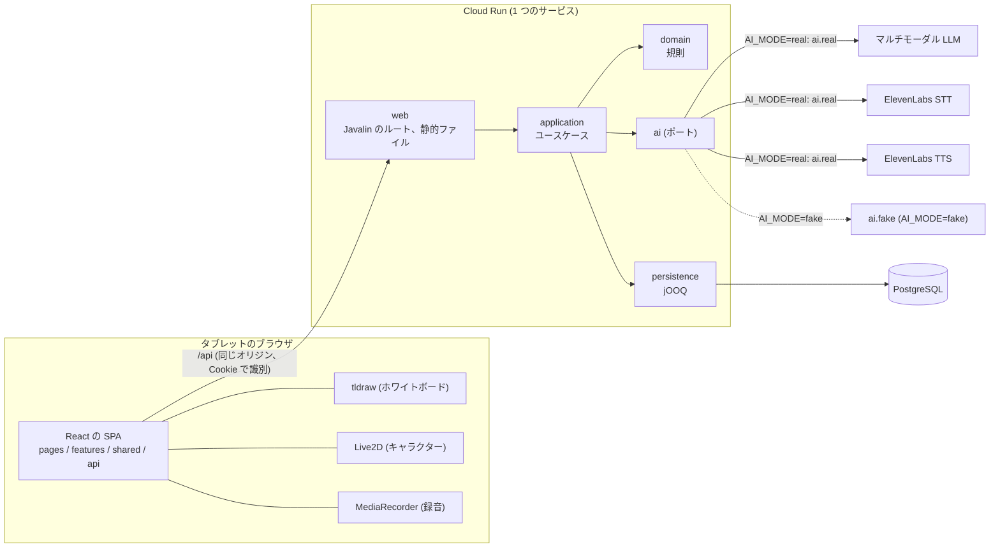
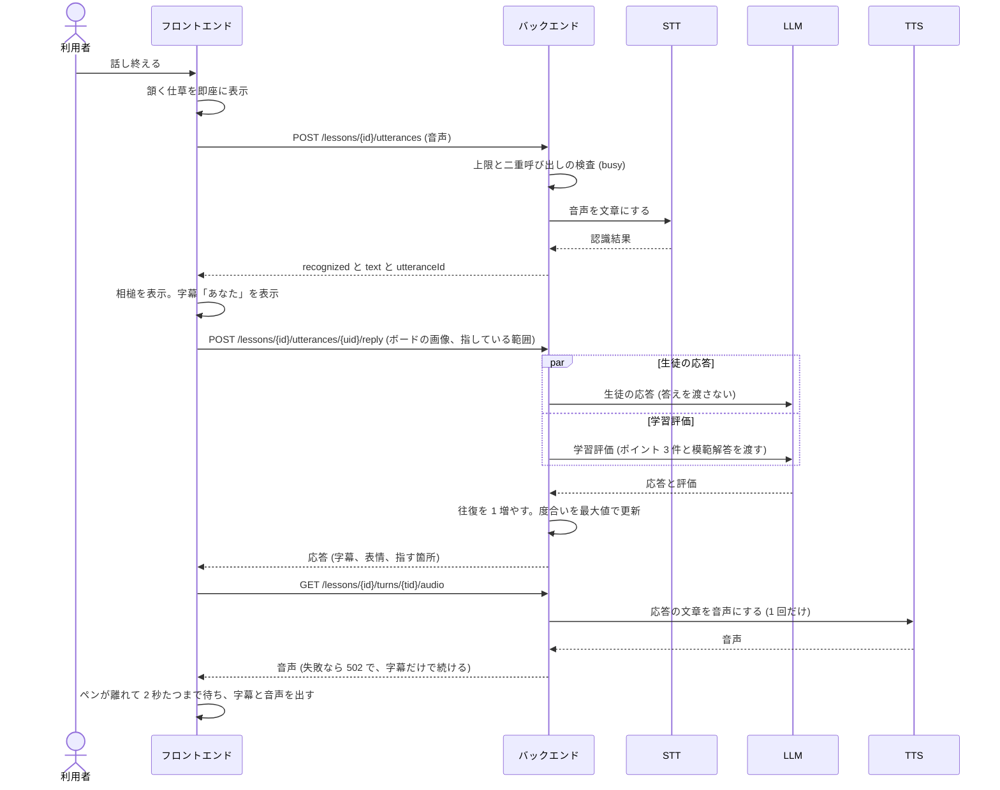
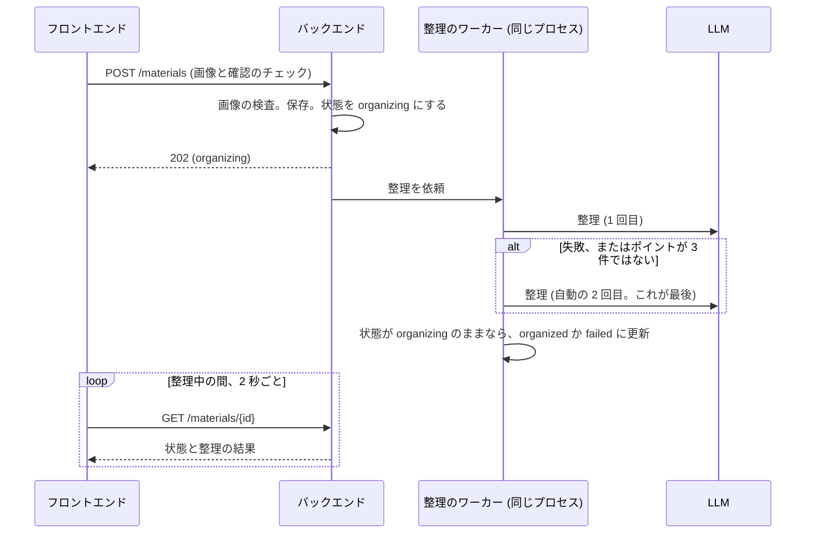
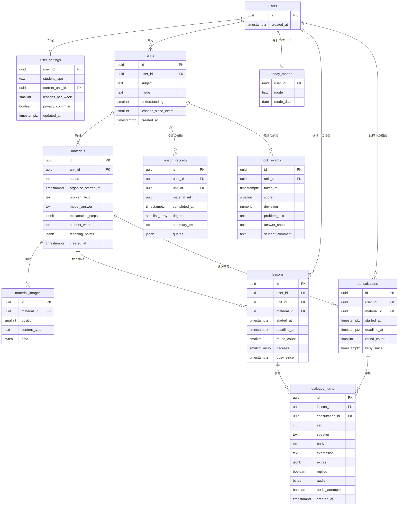

# アーキテクチャ設計: AI 生徒育成型・対話学習サービスの MVP

- 機能の親 Issue: #1 AI 生徒育成型・対話学習サービスの MVP
- 段階の Issue: #5 アーキテクチャ設計
- 参考資料: [要件定義書](requirements.md)、[仕様書](specification.md)、[概念モデル](domain-model.md)、[全体の構成](../../architecture.md)、[API の契約](../../api/openapi.yaml)、[プロジェクトの背景](../../project.md)

この文書は、この機能の設計だけを書く。技術スタック、`app/` の分け方、1 つのオリジンでの提供、モジュール間の依存の向きは、[全体の構成](../../architecture.md) に書いた。API の契約は、[`docs/api/openapi.yaml`](../../api/openapi.yaml) に書いた。この文書は、それらを前提にする。

## 1. 全体の構成との関係

この機能は、リポジトリで最初の機能である。`docs/architecture.md` と `docs/api/openapi.yaml` は、この機能で新しく作った。既存の構成を変えるところは無く、既存の API への影響も無い。

| 全体の構成のモジュール | この機能で置くもの |
| --- | --- |
| `app/frontend` の `pages` | 画面 (初期セットアップ、ホーム、先生準備室、教材の詳細、相談、授業、まとめノート、模試の結果、学習記録、単元の記録) |
| `app/frontend` の `features` | `setup`、`home`、`materials`、`consultation`、`lesson`、`mock-exam`、`records` の 7 つ |
| `app/frontend` の `shared` | `ui`、`board` (tldraw)、`avatar` (Live2D)、`audio` (録音と再生)、`image-export` (PNG の書き出し)、`lib` |
| `app/frontend` の `api` | API のクライアントと、`openapi.yaml` から生成した型 |
| `app/backend` の `domain` | 規則 (理解度、偏差値、授業の得点、上限、週の範囲、AI 生徒の種類) |
| `app/backend` の `ai` | 外部 AI のポート。`ai.real` が実際の API、`ai.fake` がテスト用のフェイク |
| `app/backend` の `persistence` | jOOQ のリポジトリ |
| `app/backend` の `application` | ユースケース |
| `app/backend` の `web` | `/api` のルートと、静的ファイルの配信 |

機能が 1 つで規模が小さいため、全体の構成の「小さいうちはフロントエンドとバックエンドの 2 つに分ける」に従い、機能ごとのモジュール分けはしない。

## 2. 構成要素とやり取り

### 2.1 構成要素

| 構成要素 | 役割 |
| --- | --- |
| React の SPA | 画面の表示、ホワイトボードと録音の操作、授業と相談の進行 (状態機械、5.2)、画像の書き出し |
| tldraw | ホワイトボード。利用者の書き込み、AI の書き込み、ボードの画像の書き出し、ペンの状態の検出に使う |
| Live2D | AI 生徒と先輩先生の表情と身振りの描画。読み込みに失敗しても、画面は進む |
| MediaRecorder | 録音 (最大 60 秒)。`aiMode` が `fake` のときは使わず、固定の短い音声データを送る |
| web | `/api` のルート、Cookie による利用者の識別、入力の検査、エラーの変換、静的ファイルの配信 |
| application | ユースケース。外部 AI の呼び出しの順序、並行、上限の検査、トランザクションを組み立てる |
| domain | 外部に依存しない規則 |
| ai (ポート) | 外部 AI の呼び出しの境界。実装は `ai.real` と `ai.fake` |
| persistence | PostgreSQL への読み書き (jOOQ) |
| PostgreSQL | 教材、記録、進行中の授業と相談の状態を保存する |
| LLM、STT、TTS | 外部 AI サービス。`real` のときだけ呼ぶ |

### 2.2 授業の 1 往復

利用者が話し終えてから、AI 生徒の応答を表示するまでのやり取り。NFR-101 のため、認識の結果を返す API と、応答を作る API を分ける (9 節)。

### 2.3 教材の整理 (非同期)

### 2.4 そのほかのやり取り

| 操作 | やり取り |
| --- | --- |
| 先輩先生への相談 | 授業と同じ 3 つの API (発話、応答、音声)。応答の LLM は 1 回で、学習評価は無い。ボードへの書き込み (`boardWrites`) を返す |
| まとめノート | チャイムの後、クライアントが、チャイム時点のボードの画像を `POST /lessons/{id}/summary` に送る。LLM を 1 回呼び、成功したら 1 つのトランザクションで記録する (7.3) |
| 模試 | `POST /mock-exams` で、LLM を 1 回呼び、成功したときだけ結果を保存して、機会を消す |
| 宿題の丸つけ | `POST /homework-checks` で、LLM を 1 回呼ぶ。保存しない |
| 画像の保存と共有 | サーバーを経由しない。クライアントが、表示中の画面の DOM を `html-to-image` で PNG にし、ダウンロードする。対応する端末では、Web Share API に渡す |
| 中断 | 画面を離れるとき、クライアントが `fetch` の `keepalive` で `POST .../abandon` を呼ぶ。届かなかったときのため、バックエンドも、古い進行中の授業と相談を消す (7.4) |

## 3. 概念モデルとの対応

概念モデルの概念が、どのモジュールとデータに当たるかを示す。表のテーブルの構造は 7 節にある。

| 概念 | バックエンドのモジュール | データの持ち方 |
| --- | --- | --- |
| 利用者 | `web` の Cookie の解決。`application.SettingsService` | `users` (識別子の Cookie `teachme_uid` と同じ値の UUID)。設定の保存時に初めて行を作る |
| 利用者の設定、個人情報の確認 | `application.SettingsService` | `user_settings`。`privacy_confirmed` は、true のときだけ設定を保存する |
| AI 生徒、AI 生徒の種類 | `domain.StudentType` (列挙型。表示名、初期偏差値、目標偏差値、性格の指示を持つ) | 種類は `user_settings.student_type` の文字列だけ。種類の表は DB に置かない (3 種類に固定のため) |
| 先輩先生 | `ai` ポートの `mentorReply`。`ai.real` の指示 | なし |
| 教科、単元 | `domain.Subject`、`application.UnitService` | `units` (教科は文字列。`(user_id, subject, name)` で一意) |
| 今日のモード | `domain.TodayMode`。`application.HomeService` | `today_modes` (モードと日付。今日と違えば、通常として読む) |
| 今週の授業 | `domain.WeekRange` (月曜 0 時から、日本時間)。`application.HomeService` | 保存しない。`lesson_records` を、今週の範囲で数える |
| 教材 | `application.MaterialService`、`MaterialOrganizer` | `materials` と `material_images` |
| 問題、模範解答、解説、生徒の途中の解答、指導のポイント | `domain.OrganizedProblem` (ポイントが 3 件であることを検査する) | `materials` の列 (`problem_text`、`model_answer`、`explanation_steps`、`student_work`、`teaching_points`)。教材 1 つに問題は 1 問 |
| 授業 | `application.LessonService`。上限は `domain.DialogueLimits` | `lessons` (進行中だけ。記録されると消える) |
| 先輩先生への相談 | `application.ConsultationService`。上限は `domain.DialogueLimits` | `consultations` (進行中だけ) |
| ボード | フロントエンドの `shared/board` (tldraw) | サーバーには保存しない。発話ごとの画像を、外部 AI に渡すためだけに受け取る |
| 利用者の発話、指している範囲 | フロントエンドの `shared/audio` と `shared/board`。API の `pointedRegions` | 録音は保存しない。認識結果の文章は `dialogue_turns` (進行中だけ)。指している範囲は、応答の材料として使い、保存しない |
| 往復 | `domain.DialogueLimits` | `lessons.round_count`、`consultations.round_count` (応答の作成に成功したときに 1 増やす) |
| 字幕 | `application` が、これまでの字幕を応答の材料に使う | `dialogue_turns` (進行中だけ。授業はまとめの成功のとき、相談は中断か期限切れのときに消す) |
| 学習評価、度合い | `ai` ポートの `evaluate`。`domain.Degrees` (最大値を保つ) | `lessons.degrees` (3 件の最大値)。発話ごとの評価結果は保存しない |
| 授業の得点 | `domain.LessonScore` (度合いの合計) | 保存しない。記録の確定時に、`degrees` から計算する |
| 中断 | `LessonService.abandon`、`ConsultationService.abandon` | 進行中の行と字幕を消す。記録は残さない |
| 授業の記録、まとめノート、引用する板書 | `application.LessonService.createSummary` | `lesson_records` (1 行に、記録の事実とまとめノートを持つ。引用する板書は `quotes` の文章の配列)。`lesson_records.id` は、授業の識別子と同じ値 |
| 理解度 | `domain.Understanding` (`min(100, 前 + 得点 × 5)`) | `units.understanding` |
| 模試の機会 | `domain.MockExamOpportunity` | `units.lessons_since_exam` (3 以上で機会あり) |
| 模試、模試の結果、解答用紙、生徒のコメント | `application.MockExamService`。偏差値は `domain.Deviation` | `mock_exams` (成功したときだけ行を作る。解答用紙と生徒のコメントも同じ行) |
| 偏差値の推移 | `application.RecordService` | 保存しない。`mock_exams` を古い順に並べて返す |
| 学習記録、学習レポート | `application.RecordService` | 保存しない。`lesson_records` と `mock_exams` から集計する (授業の数、教材の識別子の重複を除いた数、最新の模試) |
| 宿題の丸つけ、判定の結果 | `application.HomeworkService` | 保存しない |

## 4. バックエンドの設計

### 4.1 ユースケースと API

| クラス (`application`) | 受け持つ API (`openapi.yaml`) |
| --- | --- |
| `SettingsService` | `GET /settings`、`PUT /settings`、`GET /student-types` |
| `HomeService` | `GET /home`、`PUT /today-mode` |
| `HomeworkService` | `POST /homework-checks` |
| `MaterialService`、`MaterialOrganizer` | `GET/POST /materials`、`GET/DELETE /materials/{id}`、`POST /materials/{id}/retry` |
| `ConsultationService` | `/consultations` の 5 つの API |
| `LessonService` | `/lessons` の 6 つの API (開始、発話、応答、音声、まとめ、中断) |
| `MockExamService` | `POST /mock-exams`、`GET /mock-exams/{id}` |
| `RecordService` | `/records` の 4 つの API |
| `TestControlService` | `/test/*` (`AI_MODE=fake` のときだけ) |

`web` は、リクエストの検査 (形式、画像の種類と大きさ)、Cookie の解決、エラーの変換だけを行い、ユースケースを呼ぶ。

### 4.2 domain の規則

| クラス | 規則 |
| --- | --- |
| `StudentType` | 3 種類の表示名、初期偏差値、目標偏差値、性格 (応答の指示) |
| `DialogueLimits` | 授業 (20 往復、600 秒)、相談 (15 往復、600 秒)。往復が上限か、期限に達したかを判定する。時間は、テストの上書き (`PUT /test/limits`) を受け取れる |
| `Degrees` | 3 件の度合い (0 から 2)。発話の判定を、最大値で取り込む |
| `LessonScore` | 度合いの合計 (0 から 6) |
| `Understanding` | `min(100, 前の値 + 得点 × 5)` |
| `Deviation` | `初期偏差値 + 理解度 ÷ 10` を、`BigDecimal` で、小数第 1 位に四捨五入する (理解度は整数のため、結果は常に小数第 1 位までで、丸めで値は変わらない) |
| `MockExamOpportunity` | 授業の完了が 3 回で機会あり。結果の保存で 0 に戻す |
| `WeekRange` | 日本時間の月曜 0 時から日曜 24 時 |
| `OrganizedProblem` | 整理の結果。指導のポイントが 3 件でなければ、無効とする |
| `UnitName` | 前後の空白を除いて 1 文字以上 30 文字以内 |

### 4.3 外部 AI のポート (`ai`)

外部 AI は、次のインターフェースの裏に置く。`application` は、これだけを知る。

| メソッド | 呼び出し元 | 入力 | 出力 |
| --- | --- | --- | --- |
| `organize` | `MaterialOrganizer` | 教材の画像 (1 枚から 3 枚) | 問題文、模範解答、解説のステップ、生徒の途中の解答、指導のポイント (`OrganizedProblem` の元) |
| `studentReply` | `LessonService` | 生徒の種類、問題文、生徒の途中の解答、ボードの画像、発話、これまでの字幕、指している範囲 | 応答の文章、表情、`StudentAnnotation` |
| `evaluate` | `LessonService` | 指導のポイント 3 件、模範解答、解説、問題文、ボードの画像、発話、これまでの字幕、指している範囲 | 3 件の度合い |
| `mentorReply` | `ConsultationService` | 問題、模範解答、解説、指導のポイント、ボードの画像、発話、これまでの字幕、指している範囲 | 応答の文章、`boardWrites` |
| `summarize` | `LessonService` | 生徒の種類、この授業の字幕、ボードの画像 | まとめ文、引用する板書の文章の配列 |
| `mockExam` | `MockExamService` | 生徒の種類、教科、単元名、得点、直近の授業の問題とポイント (無ければ省く) | 類題、解答用紙、生徒のコメント |
| `gradeHomework` | `HomeworkService` | 宿題の写真 | 判定、コメント |
| `SpeechToText.transcribe` | `LessonService`、`ConsultationService` | 録音 | 認識結果の文章 (空もあり) |
| `TextToSpeech.synthesize` | 同上 | 話し手 (生徒の種類か先輩先生)、文章 | 音声 (mp3) |

決まり:

- すべてのメソッドは、最初の引数に `AiCallContext` (利用者の識別子と、呼び出しの種類) を受け取る。`ai.fake` は、利用者ごとに応答を決めるために使い、`ai.real` は、ログに使う。
- `studentReply` の入力の型は、模範解答、解説、指導のポイント、学習評価の結果を持たない。AI 生徒に答えを渡さない (仕様書 5.5) ことを、型で保証する。
- どのメソッドも、失敗を `AiFailedException` で表す。`ai.real` は、HTTP のタイムアウト (LLM は 30 秒、整理は 60 秒、STT と TTS は 20 秒)、応答の形の違反、HTTP の 4xx と 5xx を、すべてこの例外にする。自動の再試行はしない。
- `ai.real` は、LLM の応答を、JSON スキーマで構造化して受け取る。スキーマに合わない応答は、失敗とする。
- 指示 (プロンプト) は、`ai.real` のリソースファイル (`prompts/*.md`) に置く。生徒の種類の性格、応答の長さの目安 (生徒は 100 字、まとめは 300 字)、模試の得点の水準ごとの解答とコメントの決まり (仕様書 5.7) は、ここに書く。
- モデルは、環境変数で決める。ボードの画像を何度も渡す `studentReply` と `evaluate` は、安いモデル (`LLM_MODEL_DIALOGUE`) を使い、`organize` は、画像の読み取りが肝心なので、よいモデル (`LLM_MODEL_ORGANIZE`) を使う。
- 呼び出しごとに、種類、モデル、所要時間、成否、入力と出力のトークン数を、ログに 1 行で出す。中身は出さない。

`ai.fake` の振る舞い:

- 既定では、すべて成功の応答を返す (`openapi.yaml` の `AiScript` に、既定の応答を書いた)。
- `AiScriptControl` インターフェース (`ai` に置く) を実装する。`TestControlService` が、これを通して、利用者ごとの応答の待ち列と、呼び出しの数えを操作する。`web` は `ai.fake` を知らない。
- 待ち列は、プロセスのメモリに置く (テスト用で、Cloud Run の複数のインスタンスで動かさない)。
- ネットワークへ出ない。`AI_MODE=fake` のとき、`LLM_API_KEY` などの秘密情報は読まない。

### 4.4 進行中の授業と相談の状態

授業と相談の進行の状態は、メモリではなく DB に持つ (Cloud Run の複数のインスタンスと再起動に耐えるため)。

- 開始: `lessons` か `consultations` に行を作る。開始時刻と期限 (開始から 600 秒、または `PUT /test/limits` の値) をサーバーが決める。同じ利用者の、進行中の同じ種類の行は、先に消す (中断)。
- 処理中の印: `busy_since` 列を使う。発話、応答、まとめの処理の前に、`UPDATE ... SET busy_since = now WHERE id = ? AND user_id = ? AND (busy_since IS NULL OR busy_since < now - 90 秒)` を行う。更新できなければ 409 `busy`。処理の終わりに、`busy_since` を NULL に戻す。90 秒を過ぎた印は、異常終了の名残として無視する。
- 発話 (STT) の受け付けの条件: `round_count < 上限`、かつ `now < deadline_at`。満たさなければ、録音を捨てて 409 `limit_reached`。
- 応答の受け付けの条件: 発話が、この授業か相談の認識済みの利用者の字幕で、まだ応答していない (`replied = false`)。期限は見ない (応答の途中で期限に達しても、応答を終えるため)。応答に成功したら、字幕を保存し、`round_count` を 1 増やし、`replied` を true にし、授業では度合いを更新する。1 つのトランザクションで行う。
- 学習評価だけが失敗したときは、度合いを変えずに、応答を返す。
- まとめの受け付けの条件: `round_count >= 20`、または `now >= deadline_at - 3 秒` (クライアントの時計のずれを許す猶予)。
- まとめの成功: 1 つのトランザクションで、`lesson_records` の挿入 (`id` は授業の識別子)、`units.understanding` の更新、`units.lessons_since_exam` の加算、`lessons` と `dialogue_turns` の削除を行う。2 回目以降の同じ授業のまとめの呼び出しは、`lesson_records` から保存済みの結果を返し、LLM を呼ばない。
- 音声 (TTS): 字幕の行 1 つにつき、最大 1 回だけ生成する。`audio_attempted` を先に true にしてから呼び、失敗したら 502 を返す。生成した音声は `audio` に持ち、再度の取得に使う。字幕と一緒に消える。
- 掃除: バックエンドが、10 分ごとに、開始から 60 分を過ぎた `lessons` と `consultations` (字幕を含む) を消す。中断の通知が届かなかった場合の保険である。

### 4.5 教材の整理 (`MaterialOrganizer`)

- 登録の API は、画像を保存して状態を `organizing` にし、`organize_started_at` を記録して、すぐに 202 を返す。整理は、同じプロセスの固定 2 スレッドのワーカーで行う。
- ワーカーは、`organize` を呼び、失敗か、指導のポイントが 3 件ではないときは、1 回だけやり直す。2 回とも失敗なら `failed` にする。
- 状態の更新は、`WHERE status = 'organizing'` の条件付きで行う。教材が整理中に削除されたときや、再試行が重なったときに、結果を捨てる。
- 「やり直す」は、`UPDATE ... SET status = 'organizing' WHERE id = ? AND status = 'failed'` が 1 行更新できたときだけ、ワーカーに依頼する。更新できなければ 409 `material_not_failed`。整理中に二重に始まらない。
- バックエンドの起動時と、10 分ごとの掃除で、`organize_started_at` から 10 分を過ぎた `organizing` の教材を、`failed` にする (インスタンスの停止で整理が途切れた場合の保険。利用者は「やり直す」で再開できる)。
- Cloud Run は、整理が画面を離れても続くように、「CPU を常に割り当てる」設定 (`--no-cpu-throttling`) で動かす。リクエストを返したあとの CPU が絞られると、バックグラウンドの整理が止まるため。

## 5. フロントエンドの設計

### 5.1 画面と features

URL は、受け入れテストを書く段階で決める。次は、画面と features の対応である。

| 画面 | `pages` | 使う `features` | 呼ぶ API |
| --- | --- | --- | --- |
| 初期セットアップ (設定の変更を含む) | `SetupPage` | `setup` | `GET /student-types`、`GET/PUT /settings` |
| ホーム | `HomePage` | `home` | `GET /home`、`PUT /today-mode`、`POST /homework-checks` |
| 先生準備室 (教材の一覧、登録) | `MaterialsPage` | `materials` | `GET/POST /materials` |
| 教材の詳細 | `MaterialDetailPage` | `materials` | `GET/DELETE /materials/{id}`、`POST /materials/{id}/retry` |
| 先輩先生との相談 | `ConsultationPage` | `consultation` | `/consultations` の API |
| 授業の教材の選択と授業 | `LessonStartPage`、`LessonPage` | `lesson` | `GET /materials`、`/lessons` の API |
| まとめノート (授業の直後) | `LessonPage` の中 | `lesson` | `POST /lessons/{id}/summary` |
| 模試の結果 | `MockExamPage` | `mock-exam` | `POST /mock-exams`、`GET /mock-exams/{id}` |
| 学習記録、単元の記録、まとめノート、学習レポート | `RecordsPage`、`RecordUnitPage`、`SummaryNotePage`、`ReportPage` | `records` | `/records` の API |

### 5.2 授業と相談の進行 (状態機械)

授業の進行は、`features/lesson` の中の 1 つの reducer (状態機械) で表す。仕様書 7.3 の状態に、次のとおり対応させる。相談 (`features/consultation`) は、同じ形で、学習評価、チャイムの後のまとめ、最初の発話を持たない。

| 状態 | 仕様書 7.3 | 主な遷移 |
| --- | --- | --- |
| `opening` | 最初の発話 | `POST /lessons` の結果の `opening` を、字幕と音声で出す。終わったら `idle` |
| `idle` | 発話待ち | 「話す」で `recording` |
| `recording` | 録音中 | 「話し終える」か 60 秒で `transcribing`。上限で、録音を捨てて `chime` |
| `transcribing` | 認識中 | 結果が空か失敗なら、「うまく聞き取れませんでした。もう一度話してください」を出して `idle`。認識できたら、相槌と字幕を出して `awaitingReply` |
| `awaitingReply` | 応答中 | 応答の API の結果を待つ。失敗なら「生徒の応答を作れませんでした。もう一度話してください」を出して `idle`。成功なら `holding` |
| `holding` | 応答待ち | ペンが触れている間と、離してから 2 秒の間は、字幕も音声も出さず、頷くだけ (表情は通常)。過ぎたら `speaking` |
| `speaking` | 生徒の発話 | 字幕、表情、書き込みを出し、音声を再生する。音声が失敗したら字幕だけ。終わったら、上限に達していなければ `idle`、達していれば `chime` |
| `chime` | チャイム | 「チャイムが鳴りました。授業のまとめに入ります」を出し、書き込み中でなければ音を鳴らす。`summarizing` へ |
| `summarizing`、`summaryFailed` | まとめ生成中、まとめ失敗 | `POST /lessons/{id}/summary` を呼ぶ。失敗なら「まとめノートを作れませんでした」と「やり直す」。「やり直す」は、同じボードの画像で、もう一度呼ぶ |

規則:

- 「話す」は、`idle` のときだけ押せる。ボタンを無効にして、二重の呼び出しを防ぐ。
- チャイムの条件: ① 応答の `limitReached` が true、② 時計が `deadlineAt` に達した。時計は、`serverNow` と端末の時刻の差を補正して数える。
- 期限に達した時の状態ごとの扱い: `idle` はすぐ `chime`。`recording` は録音を捨てて `chime`。`awaitingReply` と `speaking` は、応答の字幕と音声が終わってから `chime`。`holding` は、保留中の応答の字幕を、音声なしですぐに出し、続けて `chime` とする (仕様書に定めが無いため、この文書で決めた。判断の理由は 9 節)。
- 画面を離れるとき (ページ遷移、タブを閉じる、リロード)、`POST /lessons/{id}/abandon` を `keepalive` で呼ぶ。リロードも中断として扱い、授業は最初からになる。
- 再生中の音声は、`speaking` を抜けるときに止める。

### 5.3 ボード、録音、キャラクター

- ボード (`shared/board`): tldraw を包む。初期配置 (「問題」「生徒のノート」の見出しと内容) は、`lesson` が、授業の開始の結果から作って渡す。
  - ペンの状態: ボードの要素に対するポインターイベント (`pointerdown`、`pointerup`、`pointercancel`) で、書き込み中かどうかと、最後にペンを離した時刻を追跡する。ペン、指、マウスのどれでも「触れている」とみなす (受け入れテストはマウスで行える)。`touch-action: none` をボードに設定する。
  - 指している範囲: ペンが触れたストロークごとに、時刻とボード全体に対する割合の矩形を記録する。録音を始める 10 秒前から録音を終えるまでの矩形を、最大 10 件 (新しいものを優先) で返す。
  - ボードの画像: tldraw の画像の書き出しで PNG を作る。長辺を 1280 px 以下に縮小してから送る (費用の抑制)。
  - AI の書き込み: `StudentAnnotation` と `BoardWrite` を受け取り、tldraw の図形 (矩形、矢印、文字) としてボードに追加する。
- 録音 (`shared/audio`): `MediaRecorder` で最大 60 秒。端末が対応する形式 (webm か mp4) を選ぶ。`aiMode` が `fake` のときは、`getUserMedia` を呼ばず、固定の短い音声データを返す。再生は `HTMLAudioElement`。
- キャラクター (`shared/avatar`): 表情 (通常、困り、納得、考え中) と身振り (頷く、考える、話している) を、プロパティで受け取る。Live2D のモデルと描画が読み込めないときは、静止画の代替を出し、進行は止めない。
- 画像の書き出し (`shared/image-export`): 対象の要素を PNG にして、ダウンロードする。失敗したら「画像を保存できませんでした」を出す。`navigator.canShare` が画像を受け付ける端末では、「共有する」を出す。

### 5.4 画面の見た目

- タブレットの横向きを基準に、Tailwind CSS で組む。授業と相談の画面は、左にボード、右にキャラクターと字幕を置く。ペンの操作を妨げないため、ボードの上に、タップが要るボタンを重ねない。
- ホバーに頼る操作を作らない。タップの的は 44 px 以上にする。
- 確認のダイアログ (削除) は、Radix の AlertDialog を使う。

## 6. API

契約は [`docs/api/openapi.yaml`](../../api/openapi.yaml) に書いた。この機能は、次の API を使う。仕様書の節との対応も示す。

| 区分 (tag) | パスとメソッド | 仕様書 |
| --- | --- | --- |
| system | `GET /config`、`GET /healthz` | 2.4 (フェイク)、運用 |
| setup | `GET /student-types`、`GET /settings`、`PUT /settings` | 5.1 |
| home | `GET /home`、`PUT /today-mode`、`POST /homework-checks` | 5.2 |
| materials | `GET /materials`、`POST /materials`、`GET /materials/{materialId}`、`DELETE /materials/{materialId}`、`POST /materials/{materialId}/retry` | 5.3、5.9 |
| consultations | `POST /consultations`、`POST /consultations/{id}/utterances`、`POST /consultations/{id}/utterances/{utteranceId}/reply`、`GET /consultations/{id}/turns/{turnId}/audio`、`POST /consultations/{id}/abandon` | 5.4 |
| lessons | `POST /lessons`、`POST /lessons/{id}/utterances`、`POST /lessons/{id}/utterances/{utteranceId}/reply`、`GET /lessons/{id}/turns/{turnId}/audio`、`POST /lessons/{id}/summary`、`POST /lessons/{id}/abandon` | 5.5、5.6 |
| mock-exams | `POST /mock-exams`、`GET /mock-exams/{mockExamId}` | 5.7 |
| records | `GET /records/units`、`GET /records/units/{unitId}`、`DELETE /records/units/{unitId}`、`GET /records/notes/{recordId}` | 5.8、5.9 |
| test-control | `PUT /test/ai-script`、`DELETE /test/ai-script`、`GET /test/ai-calls`、`PUT /test/limits` | 2.4 |

API の設計の要点:

- 利用者の識別は Cookie で行い、API の引数に識別子を持たない。ほかの利用者のものを指す識別子は、404 `not_found` を返す。
- 失敗の形は、`{ "error": { "code", "message", "fields?" } }` で統一した。`message` は、仕様書 10 節の文言である。
- 外部 AI の失敗は 502 とし、`code` で種類を区別する (`student_reply_failed`、`mentor_reply_failed`、`summary_failed`、`mock_exam_failed`、`tts_failed`)。教材の整理の失敗は、非同期のため、API のエラーではなく、教材の状態 `failed` で返す。STT の失敗と宿題の丸つけの失敗は、仕様書 8 節のとおり、エラーではなく結果で返す (`recognized: false`、`verdict: undetermined`)。
- 授業の最初の発話の LLM が失敗したときは、固定の文言で最初の発話を返す。仕様書に失敗時の定めが無く、授業が始められなくなる (進行不能) ことを避けるため (9 節、PR の説明に記載)。
- テスト用の API は、`aiMode` が `fake` のときだけ有効にする。`real` のときは、ルートを登録せず、404 を返す。

## 7. データの持ち方

### 7.1 テーブルの構造

### 7.2 テーブルごとの決まり

| テーブル | 決まり |
| --- | --- |
| `users` | 行は、設定を初めて保存するときに作る。`id` は、Cookie `teachme_uid` の値 (ランダムな UUID) |
| `user_settings` | 設定が完了した利用者だけが行を持つ。行が無ければ「未完了」。`student_type` は `intuitive`、`diligent`、`logical`。`lessons_per_week` は 1 から 7。`privacy_confirmed` は、保存の時点で true のものだけを入れる (check 制約で true に固定) |
| `units` | `subject` は `math` か `science`。`name` は 30 文字以内。`unique (user_id, subject, name)`。`understanding` は 0 から 100 の整数 (初期値 0)。`lessons_since_exam` は、前回の模試の結果の保存後 (最初は最初から) の授業の完了数 |
| `today_modes` | `mode` は `normal`、`self_study`、`homework_check`。`mode_date` が今日 (日本時間) でなければ、通常として読む |
| `materials` | `status` は `organizing`、`organized`、`failed`。整理の結果の列は、`organized` のときだけ値を持つ。教材の番号 (「教材 1」) は、同じ単元の中で `created_at` の順に数えて、表示のたびに求める。`unit_id` は `on delete cascade` |
| `material_images` | 教材の画像 (1 枚から 3 枚) を `bytea` で持つ。`material_id` は `on delete cascade`。教材の削除で一緒に消える。`unique (material_id, position)` |
| `lessons` | 進行中の授業だけ。`degrees` は 3 つの 0 から 2 の整数の配列 (初期値は 0 が 3 つ)。`material_id` は `on delete cascade` (整理中の削除などで教材が消えたら、授業も消える) |
| `consultations` | 進行中の相談だけ |
| `dialogue_turns` | 進行中の授業か相談の字幕。`lesson_id` か `consultation_id` のどちらか一方だけが入る (check 制約)。`speaker` は `user`、`student`、`mentor`。`body` は字幕の文章。`expression` は生徒の応答のとき。`extras` は、生徒の `annotation` か、先輩先生の `boardWrites`。`replied` は、利用者の字幕に応答したか。`audio` は、生成した音声。`unique (lesson_id, seq)` と `unique (consultation_id, seq)`。親の `on delete cascade` |
| `lesson_records` | 授業 1 回の記録とまとめノート。`id` は授業の識別子と同じ。`material_ref` は教材の識別子を持つが、外部キーにしない (教材を削除しても、記録と、教えた問題の数を残すため)。`degrees` は、3 件の最大値。`quotes` は、引用する板書の文章の配列。`unit_id` は `on delete cascade` |
| `mock_exams` | 結果が保存されたときだけ行を作る。`score` は 0 から 100。`deviation` は `numeric(4,1)`。`unit_id` は `on delete cascade` |

インデックス: `units(user_id)`、`materials(unit_id, created_at)`、`lesson_records(user_id, completed_at)` (今週の授業の数え)、`lesson_records(unit_id, completed_at)`、`mock_exams(unit_id, taken_at)`、`lessons(user_id)`、`consultations(user_id)`、`dialogue_turns(lesson_id, seq)`、`dialogue_turns(consultation_id, seq)`。

### 7.3 主な書き込み

| 操作 | 書き込み (1 つのトランザクション) |
| --- | --- |
| 設定の保存 | `users` (無ければ)、`units` (同名があれば再利用)、`user_settings` の挿入か更新 |
| 教材の登録 | `materials` (`organizing`) と `material_images` |
| 応答の成功 | `dialogue_turns` に利用者の字幕の `replied = true` と応答の字幕、`round_count + 1`、授業では `degrees` を要素ごとの `greatest` で更新 |
| まとめの成功 | `lesson_records` の挿入、`units.understanding` を `least(100, 前 + 得点 × 5)` に更新、`units.lessons_since_exam + 1`、`lessons` と `dialogue_turns` の削除 |
| 模試の保存 | `mock_exams` の挿入、`units.lessons_since_exam = 0`。行をロックして (`select ... for update nowait`) 同時の挑戦を防ぐ |
| 単元の学習記録の削除 | `lesson_records` と `mock_exams` の削除、`units.understanding = 0`、`units.lessons_since_exam = 0` |
| 教材の削除 | `materials` の削除 (`material_images`、進行中の `lessons` と `consultations` は連鎖して消える) |

### 7.4 保持と削除

- 録音は、メモリで STT に渡し、終わったら破棄する。ファイルにも DB にも書かない。
- 授業の字幕は、まとめの成功で消す。中断で消す。まとめの失敗のあいだは、「やり直す」で再利用するため残す。相談の字幕は、中断で消す。どちらも、開始から 60 分を過ぎたら、掃除で消す。
- 宿題の写真と判定の結果は、メモリだけで扱い、保存しない。
- ボードの画像は、メモリだけで扱う。保存しない (引用する板書は、LLM が文章に書き起こしたものを `quotes` に残す)。
- 利用者のデータの削除は、教材の削除と、単元の学習記録の削除の 2 つ (NFR-303)。アカウントの削除は無い。

## 8. 非機能要件への対応

要件定義書の非機能要件 (NFR-*) と、`docs/project.md` の制約を、どの仕組みで満たすかを示す。

| 要件 | 満たす仕組み |
| --- | --- |
| NFR-101 待ち時間を感じさせないリアクション | ① 「話し終える」を押した瞬間に、フロントエンドが頷く仕草を出す。② 発話の API (STT だけ) と、応答の API (LLM) を分け、認識の結果が返った直後に、相槌と字幕「あなた」を出す。③ 生徒の応答と学習評価の 2 つの LLM を並行して呼ぶ (`CompletableFuture`)。④ 応答の JSON が届いたら、すぐに音声の取得を始め、ペンの待ちの 2 秒に音声の生成を重ねる。⑤ 学習評価の結果は、利用者には見せず、応答の表示を待たせるだけにする。応答の速さは、人が判断する (仕様書 3 節)。応答の速さに数値の目標は置かない |
| NFR-201 時間と回数の上限 | 上限は、サーバーが強制する。① 開始時刻と期限は、サーバーが決める。クライアントの申告は信じない。② 発話の受け付けは、`round_count < 上限` かつ `now < deadline_at` のときだけ。満たさなければ録音を捨てて 409。③ 往復は、応答の成功と同じトランザクションで数える。④ 1 つの授業と相談に、処理中の印 (`busy_since`) を置き、同時に 1 つの処理だけを通す。⑤ 1 回の発話の LLM の呼び出しは、2 回に固定する。自動の再試行は、教材の整理の 1 回だけ。⑥ 録音は 60 秒と 5 MB まで。⑦ 応答 1 つの音声は、1 回だけ生成する。⑧ 外部呼び出しには、タイムアウトを付ける (4.3)。⑨ 往復に数えない失敗 (認識の空、応答の失敗) が続いても、10 分の期限で止まる。⑩ クライアントの時計とのずれは、`serverNow` で補正し、まとめには 3 秒の猶予を持たせる。フロントエンドは、同じ上限でチャイムを出す (5.2)。`GET /test/ai-calls` で、呼び出しの数が上限を超えないことを、受け入れテストが確かめる |
| NFR-301 外部 AI サービスへの送信 | ① 送る内容は、`ai` ポートの入力の型で、処理に必要なものだけに限る。氏名、学校名、連絡先を持つ項目は、DB にも、API にも、ポートの型にも置かない。② 授業と相談の API は、設定の `privacy_confirmed` が無い利用者に 409 `privacy_not_confirmed` を返す (音声、字幕、ボードの画像を送らない)。③ 教材の登録と宿題の丸つけは、`photoConfirmed` が true でなければ 400 `photo_not_confirmed` を返し、画像を保存も送信もしない。フロントエンドも、チェックが無ければボタンを押せなくする。④ 利用者の発話、画像の中身の個人情報は、検出も除去もしない (仕様書 2.2)。授業と相談の画面と、初期セットアップに、注意を出す。⑤ ログに、発話、字幕、ボード、画像の中身を出さない。⑥ 通信は、Cloud Run の HTTPS。秘密情報は、環境変数 (Secret Manager から注入) で持ち、リポジトリにも画面にも出さない |
| NFR-302 保存するデータ | 7 節のとおり、教材 (画像と整理の結果)、まとめノート、模試の結果、理解度を、利用者の識別子に結びつけて PostgreSQL に保存する。録音は保存しない。字幕とボードの画像は、7.4 のとおり、記録の後に残さない。同じブラウザで開き直せば、Cookie の有効期間 (400 日) のあいだ、同じ記録が見える |
| NFR-303 削除 | `DELETE /materials/{id}` と `DELETE /records/units/{id}` を、それぞれ 1 つのトランザクションで行い、何度呼んでも 204 を返す (二重の押下に耐える)。フロントエンドは、確認のダイアログを 1 つだけ出し、実行中はボタンを無効にする |
| NFR-304 共有の範囲 | 画像の書き出しは、クライアントだけで行い、サーバーに画像を送らない。URL を発行する API、他の利用者の記録を返す API を、作らない。ほかの利用者の識別子を指すリクエストは、404 を返す |
| 利用環境 (タブレット、横向き、ペン、マイク) | 5.3 と 5.4 のとおり。ポインターイベントで、ペン、指、マウスを同じに扱う。横向きを基準にした Tailwind のレイアウト。録音は MediaRecorder で、webm と mp4 のどちらにも対応する (タブレットのブラウザの違い) |
| 外部 AI の費用 (`docs/project.md`) | ① 上限 (NFR-201) が、暴走の防止の本体である。② 画像を渡す呼び出しは、画像の長辺を 1280 px 以下に縮小して送る。③ 回数の多い `studentReply` と `evaluate` は、安いモデルを使う。④ TTS は、応答 1 つにつき 1 回までで、まとめ文と相槌は音声にしない。⑤ 呼び出しごとに、種類、モデル、トークン数をログに出し、費用を後から集計できるようにする。⑥ 運用で、クラウドの予算のアラートと、Cloud Run の最大インスタンス数 (2) を設定する (10 節) |
| 受け入れテストの制約 (Secrets が無い) | `AI_MODE=fake` で、`ai.fake` を組み立てる。秘密情報を読まない。応答の成功と失敗を、`PUT /test/ai-script` で利用者ごとに決められる。STT の認識結果も、同じ仕組みで決める。フロントエンドは、`aiMode` が `fake` のとき、マイクを使わない。`PUT /test/limits` で、授業と相談の時間の上限を短くできる。起動の方法は、全体の構成の 2.2 に書いた |
| 運用 | ① ログは、標準出力に、1 行 1 件の形式で出し、Cloud Logging に集める。外部 AI の呼び出しの記録、失敗の記録 (種類と HTTP の状態) を含め、中身は含めない。② `GET /api/healthz` (本文は `ok`) を、稼働の確認に使う。③ 本番で `AI_MODE=fake` を指定すると、起動に失敗する。④ DB のスキーマは、起動時に Flyway で移行する |
| 品質の水準 (MVP) | 単体テストは、規則 (`domain`) と、DB の統合テスト (Testcontainers)、状態機械 (reducer) に絞る。依存の向きは、ArchUnit と dependency-cruiser で確かめる。性能、可用性、負荷の試験は、行わない (10 節) |

## 9. 判断の理由

| 判断 | 理由 | 採らなかった選択肢と、その理由 |
| --- | --- | --- |
| React Router を SPA のモードで使い、バックエンドが静的ファイルを配信する | サーバー側の描画が要らない。成果物が静的ファイルだけになり、コンテナ 1 つで、画面と API を 1 つのオリジンにできる。受け入れテストも本番と同じ形で動かせる | フレームワークのモード: Node.js のサーバーが増え、納期に合わない。Web サーバー (nginx など) を置く: 部品が増える。静的ファイルの配信は Javalin で足りる |
| 利用者の識別を Cookie の UUID にする | 仕様書 1.1 が、ブラウザごとの識別子を求めている。ログインが要らない。`HttpOnly` の Cookie なら、ページのスクリプトから識別子を読めない。Playwright の `request` と `page` が Cookie を共有するため、テストの利用者ごとの隔離も簡単 | `localStorage` に識別子を持ち、ヘッダーで送る: スクリプトから読めるうえ、全 API の呼び出しに付ける手間が増える。アカウント方式: スコープ外 |
| 授業と相談の進行の状態を DB に持つ | Cloud Run は、インスタンスが増減し、再起動する。メモリの状態だと、往復の数えや上限が狂い、費用の上限を守れない | メモリで持つ: 最大インスタンス数を 1 にしても、再起動で失われる。Redis: 部品が増え、規模に合わない |
| 発話の API (STT) と応答の API (LLM) を分ける | NFR-101 の、認識の直後の相槌を、サーバーの応答の完了を待たずに出すため | 1 つの API で、認識から応答まで行う: 相槌が遅れる。ストリーミング (SSE や WebSocket): 実装が重く、フェイクとテストも複雑になる。MVP は、2 回の HTTP で足りる |
| 応答の音声を、別の API (`GET .../audio`) にする | 応答の字幕を先に返せる。音声が失敗したら、字幕だけで続ける仕様 (仕様書 8 節) に合う。1 つの応答に 1 回だけ生成する、という費用の上限を、サーバーで守れる | 応答の JSON に音声を埋める: 失敗の扱いと大きさが悪い。任意の文章を音声にする API: 費用の暴走を許す |
| 教材の整理を、非同期のワーカー (同じプロセス) で行う | 仕様書 5.3 が、画面を離れても整理が続くことを求めている。MVP の規模なら、ジョブの基盤は要らない | メッセージキューや Cloud Tasks: 部品が増える。リクエストの中で同期して待つ: 画面を離れると途切れ、時間が長いと切れる。インスタンスが止まった場合は、期限を過ぎた `organizing` を `failed` にして、利用者が「やり直す」で再開できるようにした |
| Cloud Run に「CPU を常に割り当てる」設定を使う | 整理のバックグラウンドの処理が、リクエストの後も進むため | リクエスト時だけの CPU: 整理が止まる。利用が少ないため、増える費用は小さい (最大インスタンス数 2) |
| 画像を PostgreSQL の `bytea` に保存する | 規模 (100 人、教材 1 枚から 3 枚) が小さく、保存先が 1 つで済む。教材の削除で、画像も同じトランザクションで消せる (NFR-303) | Cloud Storage: 部品と権限が増え、削除の整合も別に取る必要がある。規模が大きくなった時の課題とする |
| jOOQ のコードを git に入れ、Flyway で DB を移行する | 既定の jOOQ は、スキーマから生成する。生成のたびに Docker を要さないようにする。起動時に、順序のある SQL を適用できる | 実行時に DB から生成: ビルドが Docker に依存する。Flyway を使わず、手で SQL を実行する: 本番の移行の手順が増える |
| ポートの入力の型で、AI 生徒に答えを渡さないようにする | 「AI 生徒は答えを知らない」は、この機能の中心である (仕様書 5.5)。指示の文章だけに頼ると、変更で破れる | 指示で「答えを言わないで」と頼む: 守られる保証が無い |
| 往復を、応答の作成の成功時にサーバーで数える | 上限をサーバーが強制するため。仕様書 5.5 は、「字幕が表示された時点」で数えるが、ペンの待ち (2 秒) で表示が遅れても、1 往復は 1 往復であり、数えの結果は変わらない | クライアントが数えて申告する: 費用の上限を守れない |
| 期限に達したとき `holding` の応答を、音声なしですぐに出してチャイムを鳴らす | 仕様書 5.5 は「書き込みが続く間はいつまでも待つ」と「書き込み中でもチャイムは表示する」を定めるが、両者が衝突したときの順序は定めていない (概念モデル 6 節の未確定点)。応答は、すでに費用をかけて作り、往復も数えているため、捨てずに出す。チャイムで授業を止められるため、進行不能にならない | 保留の応答を捨てる: 数えた往復と食い違う。チャイムを、書き込みが終わるまで遅らせる: 時間の上限が守れず、進行も止まる |
| 最初の発話の LLM が失敗したら、固定の文言を出す | 仕様書は、最初の発話の失敗を定めていない。授業を始められないのは、進行不能であり、致命的な異常系になる | 授業の開始を失敗にする: 利用者が先へ進めない。再試行する: 費用の暴走の可能性 |
| 引用する板書を、文章 (式は文字) の配列にする | 仕様書は、引用する板書の形を定めていない。ボードの画像を切り出して保存すると、位置の特定と画像の保存が必要になり、MVP の費用に合わない。文章なら、まとめノートも画像書き出しも、画面の DOM だけで済む | 画像の切り抜き: 範囲の特定が難しく、保存先も増える |
| 問題文の図表を、Markdown の表と文章の説明にする | 仕様書は、図表の形を定めていない。清書を LLM が行うため、画像を再生成せず、文字で表す | 図の画像を生成して保存する: MVP の費用に合わない |
| 模試の材料は、直近の授業の教材の問題とポイントとする。その教材が削除されていれば、教科、単元名、種類、得点だけで作る | 概念モデル 6 節の未確定点 (教材を削除した後の模試の材料) への対処。整理の結果の複製を持たない (概念モデルの方針) ため、材料が無いときの代替を決める | 模試の機会を消す: 利用者が挑戦できなくなる。整理の結果を複製して保存する: 概念モデルの方針に反する |
| 模試の材料の、複数の教材がある単元では、直近の記録の授業の教材のポイント 3 件を使う | 仕様書 5.7 は「その単元の指導のポイント 3 件」とするが、教材ごとに 3 件があり、どの 3 件かが定まらない (概念モデル 6 節)。「直近の授業で使った問題」と同じ問題の 3 件に合わせる | 単元共通のポイントを作る: 概念モデルの方針に反する |
| 状態機械を、授業と相談で別々の reducer にする | 授業には学習評価、チャイムの後のまとめ、最初の発話があり、相談には無い。共通化すると条件分岐が増える。同じ部品 (`shared/board`、`shared/audio`) を使い、重複は小さい | 1 つの汎用の状態機械: 条件分岐が増え、納期に合わない |

## 10. 範囲の判断

### 10.1 判断の材料

- 方針 (`docs/project.md`): 優先順位は D (納期) > C (費用) > Q (品質)。品質の水準は MVP で、受け入れテストでは、主要なユーザーフローの正常系と、API の無限ループ (トークンと音声の生成の費用の暴走) や進行不能になる致命的な異常系だけを確かめる。エッジケースの網羅、過剰な性能の最適化、複雑な権限管理は行わない。
- 規模と期限: 利用者は数十人から 100 人規模。期限は 2026/10/30 23:59 まで。外部 AI の費用は、Codex の API 利用料で 10 ドル未満の見積もり。
- 機能の事情 (親 Issue #1、要件定義書): 数学と理科の 2 教科に絞った検証。ホワイトボード (tldraw)、Live2D、ElevenLabs が必須技術。受け入れテストは外部 AI をフェイクに差し替え、手書き、音声入力、Live2D、音声の自然さは人が判断する。要件定義書の非機能要件は、NFR-101 (テンポ)、NFR-201 (上限)、NFR-301 から NFR-304 (データ) である。

### 10.2 扱うこと、扱わないこと

| 非機能の観点 | 扱うこと | 扱わないこと | 理由 |
| --- | --- | --- | --- |
| 費用の暴走の防止 (NFR-201) | 上限のサーバーでの強制、処理の二重実行の防止、LLM の呼び出しの数の固定、TTS の 1 応答 1 回、タイムアウト、画像の縮小、モデルの使い分け、呼び出しの記録 | 利用者ごと、1 日ごとの呼び出しの上限。外部 AI の予算を超えたときのアプリ側の停止 | 方針が、費用の暴走を、確かめる致命的な異常系として名指ししている。一方、利用者が 100 人規模で、悪意のある利用は想定せず、予算のアラートと Cloud Run の最大インスタンス数 (運用) で足りるため、アプリ側の利用者ごとの上限は、納期を優先して作らない |
| セキュリティ、個人情報 (NFR-301、302、303、304) | 確認のチェックのサーバーでの強制、必要なデータだけを外部へ送る型、ログに中身を出さない、Cookie の `HttpOnly` と `SameSite=Lax`、利用者ごとの隔離 (404)、削除の冪等 | ログイン、権限の区別、CSRF のトークン、レート制限、個人情報の検出と除去、保存データの暗号化 (DB の標準の暗号化を除く)、監査ログ | 権限の複雑な管理は行わない (方針)。要件定義書が、検出と除去をしない方式を定めている (NFR-301)。`SameSite=Lax` で、別のサイトからの更新の POST に Cookie が付かないため、CSRF のトークンは省く |
| 性能 (NFR-101) | 認識と応答の API の分離、LLM の並行呼び出し、音声の先取り、ボードの画像の縮小 | 数値の目標 (応答の秒数の上限など)、負荷の試験、キャッシュ、CDN、ストリーミング、データベースの最適化 | 過剰な性能の最適化は行わない (方針)。テンポは、人が判断する (要件定義書 7.1)。100 人規模のため、DB は単純な索引だけにした |
| 可用性、拡張 | 状態を DB に持つ (インスタンスの再起動と増減に耐える)、整理が止まったときの回復 | 冗長化、自動の復旧、複数リージョン、DB のレプリカ、ジョブの基盤、ゼロダウンタイムの移行 | MVP の検証であり、停止のコストが小さい。最大インスタンス数は 2 とする |
| 運用 | 構造化ログ、`/healthz`、外部 AI の呼び出しの記録、本番で `fake` を禁止、Flyway の移行 | メトリクスの収集と可視化、アラートの設計 (予算のアラートを除く)、障害の訓練 | MVP の水準。ログから、費用と失敗は後から集計できる |
| テスト | `domain` の単体、状態機械の単体、DB の統合 (Testcontainers)、依存の向き (ArchUnit と dependency-cruiser)、`GET /test/ai-calls` による呼び出しの数の確認 | ブラウザの機種ごとの動作、タブレットの実機の自動試験、手書きと音声の自動試験、Live2D の描画の試験 | 受け入れテストの範囲は、画面遷移、表示内容、対話の往復まで (要件定義書 7.1、`docs/project.md`) |
| 画面の見た目 | 横向きのタブレットを基準にした配置 | 縦向きの最適化、ほかの端末のデザイン | 利用環境が、タブレットの横向きに限られる (`docs/project.md`) |
| データ | 7 節の構造 | 教材の画像の外部ストレージ、履歴の長期保管、バックアップの方針 | 規模が小さい。DB のバックアップは、マネージドの PostgreSQL の標準の機能に任せる |

### 10.3 この文書の中で決めないこと

- 受け入れテストの画面の URL と、要素の見つけ方 (受け入れテストを書く段階で決める)。
- 授業と相談の 10 分の上限を、テストで実際に待つか、`PUT /test/limits` で短くするか。API は、短くできる形で用意した (仕様書 2.4 が、後の段階に任せている)。
- 理解度と偏差値の計算式の値 (仕様書が暫定とし、人が決める)。

## 11. 実装の分け方 (後の段階への目安)

後の段階で、プロジェクトの土台とテストと実装タスクに分けるときの、この設計からの目安である。依存の順に並べる。

1. プロジェクトの土台: `app/frontend` (Vite、React、Tailwind、Oxc、Vitest、dependency-cruiser)、`app/backend` (Gradle、Javalin、jOOQ、Flyway、Spotless、JUnit、Testcontainers、ArchUnit)、`app/Dockerfile`、`scripts/start-app.sh` (PostgreSQL の起動、フロントエンドのビルド、`AI_MODE=fake` と `PORT` でのバックエンドの起動)、`scripts/test.sh`。依存の向きの規則 (全体の構成の 4 節) を、ArchUnit と dependency-cruiser に書き起こす。
2. 共通の基盤: Cookie の解決、エラーの形、`Clock`、静的ファイルの配信と SPA のフォールバック、`GET /config`、`GET /healthz`、`ai` のポートと `ai.fake` (`AiScript` の既定の応答、`/test/*`)。
3. 初期セットアップとホーム: `/settings`、`/student-types`、`/home`、`/today-mode`、`/homework-checks` と、対応する画面。
4. 教材の整理: `/materials` の API、`MaterialOrganizer`、画面。
5. 授業: `/lessons` の API (開始、発話、応答、音声、まとめ、中断)、`shared/board`、`shared/audio`、`shared/avatar`、状態機械、画面。
6. 先輩先生への相談: `/consultations` の API と画面 (4 の部品を再利用)。
7. 模試と学習記録: `/mock-exams`、`/records`、画像の書き出し、削除。
8. 実際の外部 AI (`ai.real`)、Live2D のモデルの組み込み、本番の `Dockerfile` と Cloud Run の設定。`ai.fake` で 7 までを通した後に行う。
