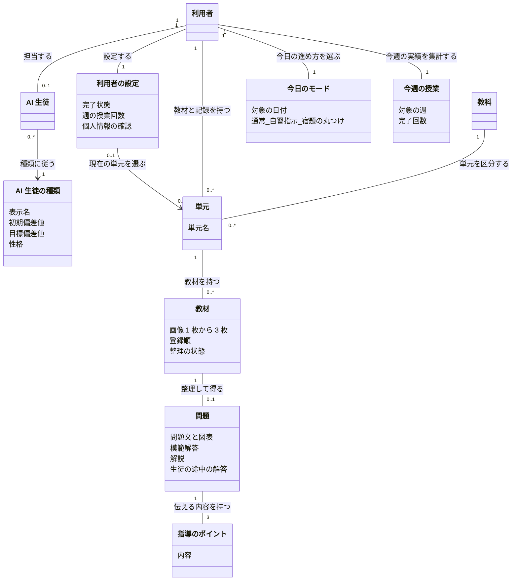
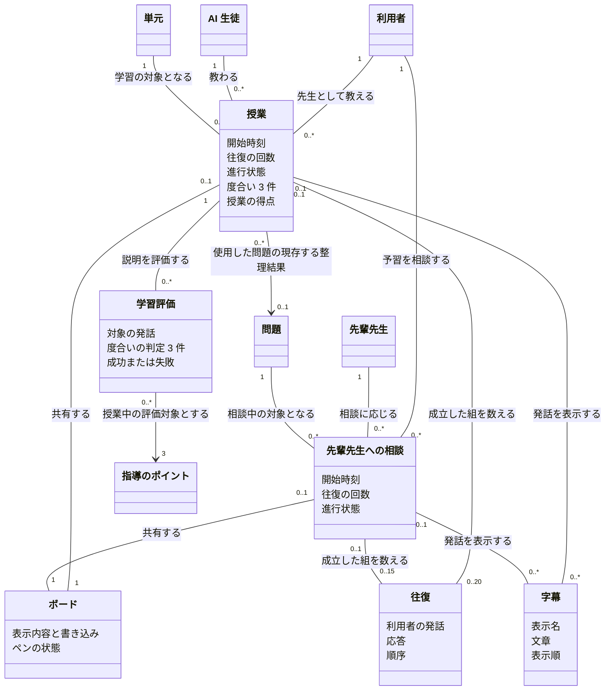
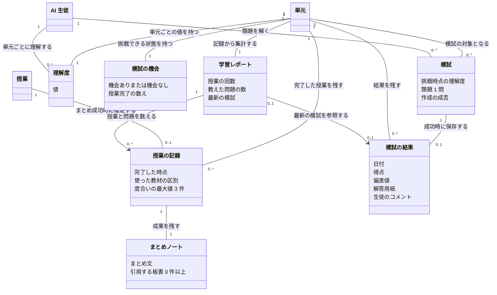

# 概念モデル: AI 生徒育成型・対話学習サービスの MVP

- 機能の親 Issue: #1 AI 生徒育成型・対話学習サービスの MVP
- 段階の Issue: #4 概念モデル
- 根拠: [仕様書](specification.md)

## 1. モデルの読み方と対象

この文書は、仕様書に登場する役割、教材、対話、学習の成果と、その関係を表す。表の「仕様の根拠」「仕様の箇所」と 6 節の「箇所」は仕様書の節番号を示す。本文の節参照は、この文書内の参照である。仕様書が暫定値として定めた生徒の偏差値と理解度の計算式も、そのまま扱う。

利用者は授業で先生の役割を担い、担当する AI 生徒に教える。予習では先輩先生に相談する。教材から整理された問題を使って授業を行い、まとめノートの作成に成功した時点で授業の記録が残る。その記録を基に、単元ごとの理解度、模試の機会、学習レポートが成立する。

- 利用者の範囲は、同じブラウザで継続して使う記録の持ち主とする。同じ人でも、別のブラウザや端末の記録とは別に扱う。
- 教科は数学と理科に限る。アカウント登録、ログイン、端末間の共有、利用者間の交流は含めない。
- 「先生準備室」「ホーム」「生徒のノート」は、仕様に定められた場面や表示上の区分であり、独立した記録の持ち主や学習対象にはしない。
- 図中のクラスは業務上の概念を表す。文章、得点、状態などの値は、概念一覧や図の属性として表す。保存方法や実装上のクラス構成は定めない。
- 図を 3 つに分ける。同じ名前の概念は、どの図でも同じ概念を指す。`0..1` は無いか 1 つ、`0..*` は 0 個以上、`1` や `3` はその個数に限ることを表す。

## 2. 概念の一覧

### 2.1 利用者と担当する学習

| 名前 | 意味 | 主な属性・内包する値 | 仕様の根拠 |
| --- | --- | --- | --- |
| 利用者 | サービスを使い、授業では先生になる人。教材と学習記録の持ち主 | 利用者の設定、担当する AI 生徒、所有する単元 | 1.1、1.2、5.1、5.10 |
| 利用者の設定 | 学習を始めるために決める担当と授業の予定 | 未完了／完了、担当する生徒、現在の教科と単元、週の授業回数、個人情報の確認 | 5.1、7.1 |
| AI 生徒 | 利用者が教える相手。利用者ごとに担当を選ぶ | 種類、応答の文章、表情、単元ごとの理解度 | 1.2、1.3、5.5、6.3 |
| AI 生徒の種類 | 生徒の応答方針と偏差値の基準を定める区分 | 表示名、初期偏差値、目標偏差値、性格 | 1.3 |
| 先輩先生 | 教材の内容を知り、利用者の予習を助ける AI のメンター | 応答の文章、ボードに書く図・式・ポイント | 1.2、5.4 |
| 教科 | 単元を分ける学習分野 | 数学／理科 | 2.1、5.1 |
| 単元 | 利用者が教科の中で名前を付ける学習の区切り | 単元名、教科、教材、理解度、模試の機会の数え、学習記録 | 1.2、5.1、5.7～5.9 |
| 今日のモード | 利用者がその日に選んでいる学習の進め方 | 対象の日付、通常／自習指示／宿題の丸つけ | 1.2、5.2、7.4 |
| 今週の授業 | 利用者が今週に完了した授業の回数 | 対象の週、完了回数。設定された週の授業回数と並べて表示する | 1.1、1.2、5.1、5.2、5.6 |
| 個人情報の確認 | 利用者が、外部へ送る内容について行う確認 | 音声・字幕・ボードについての確認、選んだ写真についての確認、それぞれの確認済み／未確認 | 5.1～5.3、5.10 |

AI 生徒の種類は次の 3 つに限る。目標偏差値は表示用の値であり、理解度や模試の計算には使わない。

| 種類 | 初期偏差値 | 目標偏差値 | 性格 |
| --- | --- | --- | --- |
| 直感・感覚派 | 45 | 50 | 難しい専門用語に弱く、図解や身近な具体例を求める |
| 真面目な暗記派 | 52 | 58 | 公式は覚えているが、解き方を使う発想の過程を質問する |
| 論理・ツッコミ派 | 60 | 65 | 説明の飛躍や例外ケースを質問する |

### 2.2 教材と整理の結果

| 名前 | 意味 | 主な属性・内包する値 | 仕様の根拠 |
| --- | --- | --- | --- |
| 教材 | 利用者が現在の単元に登録する問題集やプリントの写真のまとまり | 画像、登録順、整理の状態、整理の結果 | 1.2、5.3、7.2、9 |
| 問題 | 教材を整理して得られる 1 問 | 清書した問題文、図表、模範解答、解説、生徒の途中の解答、指導のポイント | 1.2、5.3 |
| 模範解答 | 問題の正しい解答として整理された内容 | 解答の内容 | 5.3～5.5 |
| 解説 | 模範解答に至る解き方を段階に分けた説明 | 解説のステップとその順序 | 5.3～5.5 |
| 生徒の途中の解答 | 途中まで解いて手が止まっている状態の解答 | 途中までの解答の内容 | 5.3、5.5 |
| 指導のポイント | AI 生徒に伝えるべき重要な内容 | ポイントの内容。問題ごとに必ず 3 件 | 1.2、5.3、6.1、9 |

模範解答、解説、生徒の途中の解答は、図では問題の属性として表す。「整理の結果」は、問題とこれらの内容をまとめた呼び方とする。

### 2.3 授業と相談の対話

| 名前 | 意味 | 主な属性・内包する値 | 仕様の根拠 |
| --- | --- | --- | --- |
| 授業 | 1 つの問題を使い、利用者が AI 生徒に教える 1 回のまとまり | 開始時刻、経過時間、進行状態、往復の回数、指導のポイントごとの度合い、授業の得点 | 1.2、5.5、6.1～6.3、7.3 |
| 先輩先生への相談 | 整理済みの教材を使い、利用者が予習の質問をする 1 回のまとまり | 開始時刻、経過時間、往復の回数、進行中／時間終了／中断 | 5.4、8、9 |
| ボード | 問題、解答、図や式などを示し、対話の内容を共有する場 | 表示内容、利用者と AI の書き込み、書き込み中かどうか、最後にペンを離した時点 | 5.4、5.5 |
| 利用者の発話 | 利用者が話した 1 回分の内容 | 録音、認識結果、発話の時点のボードの内容、指している範囲 | 5.4、5.5、9 |
| 指している範囲 | 利用者が発話と関連付けてペンで示したボード上の範囲 | 録音開始前 10 秒から録音終了までに触れた範囲。触れていなければ無し | 5.4、5.5、9 |
| 往復 | 利用者の発話 1 回と、それに対する AI の応答 1 回の組 | 利用者の発話、応答、対話内での順序 | 1.2、5.4、5.5 |
| 字幕 | 利用者または AI の発話を文字で表したもの | 表示名、文章、表示順。表示名は「あなた」「生徒」「先輩先生」 | 1.2、5.4、5.5、5.10 |
| 学習評価 | 利用者の説明が、指導のポイントをどれだけ伝えたかを判定すること | 対象の発話、ポイント 3 件それぞれの判定、成功／失敗 | 5.5、6.1、8 |
| 度合い | ある授業で、ある指導のポイントが伝わった程度 | 0: 伝わらなかった、1: 一部伝わった、2: 分かりやすく伝わった。授業中は判定の最大値を保つ | 1.2、6.1 |
| 授業の得点 | 授業で伝わった内容の合計 | 記録確定時の 3 件の度合いの合計。0 以上 6 以下の整数 | 6.2 |
| 中断 | 授業や相談を継続せず、画面を離れること | 対象の授業または相談。授業ではチャイムの前の離脱を指す | 1.2、5.4、5.5、8 |

AI の応答は、授業では AI 生徒の文章・表情・指す箇所や「？」の印、相談では先輩先生の文章・図・式・ポイントを含む。AI 生徒の最初の発話と相槌は、往復の応答には含めない。度合いは、指導のポイント自体の固定属性ではなく、授業ごとに異なる値である。

### 2.4 学習の成果と宿題

| 名前 | 意味 | 主な属性・内包する値 | 仕様の根拠 |
| --- | --- | --- | --- |
| 授業の記録 | まとめノートの作成まで成功した授業について残す事実 | 完了した時点、単元、授業に使った教材の区別、3 件の度合いの最大値、まとめノート。完了回数の集計の基になる | 5.6、5.8、5.10、6.2 |
| まとめノート | AI 生徒の言葉で授業の内容を整理した成果物 | まとめ文、引用する板書、作成順 | 5.6、5.8 |
| 引用する板書 | 利用者の図や式から、分かりやすいものとしてまとめに取り込む内容 | 授業のボードから選ばれた図や式。0 件以上 | 5.6 |
| 理解度 | AI 生徒がその単元をどれだけ理解したかを表す内部の値 | 0 以上 100 以下の整数。初期値は 0 | 1.2、6.3 |
| 模試の機会 | 単元で授業が一定回数完了し、模試に挑戦できる状態 | 機会あり／機会なし、前回の模試結果の保存後からの授業完了の数え | 1.2、5.7、7.5 |
| 模試 | AI 生徒の理解を結果として返す挑戦 | 挑戦した時点の理解度、直近の授業で使った問題、指導のポイント 3 件、生徒の種類、類題 1 問、作成の成否 | 5.7 |
| 模試の結果 | 模試に成功して保存された成果 | 日付、得点、偏差値、解答用紙、生徒のコメント | 5.7、5.8、6.4、6.5 |
| 解答用紙 | 類題を AI 生徒が解いた内容 | 得点の水準に合った解答 | 5.7 |
| 生徒のコメント | 模試を解いた AI 生徒が述べる内容 | 指導のポイント 3 件に関する、得点の水準に合ったコメント | 5.7 |
| 偏差値の推移 | 単元ごとの模試結果を時系列で見たもの | 古い順の日付と偏差値の組 | 5.7 |
| 学習記録 | 単元に残された授業と模試の成果のまとまり | 授業の記録、まとめノート、模試の結果 | 5.8～5.10 |
| 学習レポート | 単元の学習記録から求める集計 | 単元名、授業の回数、教えた問題の数、最新の模試の得点と偏差値 | 5.8 |
| 宿題の丸つけ | 今日のモードが宿題の丸つけのときに、利用者の写真を判定すること | 宿題の写真 1 枚、写真についての確認、判定の結果 | 5.2、8、9 |
| 判定の結果 | 宿題の写真について返す一時的な内容 | 正解／不正解／判定できない、一言のコメント | 5.2、5.10 |

解答用紙と生徒のコメントは図では模試の結果の属性として、引用する板書はまとめノートの属性として表す。学習記録は既存の成果のまとまり、学習レポートと偏差値の推移はその成果から導く表示内容であり、別の授業や別の模試を意味しない。

## 3. 概念どうしの関係

### 3.1 利用者、設定、教材

| 関係 | 意味と多重度 |
| --- | --- |
| 利用者と利用者の設定 | 利用者 1 人につき設定は 1 つ。未完了も設定の状態として扱う |
| 利用者と AI 生徒 | 未完了では担当は未選択の場合がある。設定完了後は利用者 1 人が AI 生徒 1 人を担当し、その担当は変えられない |
| AI 生徒と AI 生徒の種類 | AI 生徒 1 人の種類は必ず 1 つ。同じ種類を複数の利用者が選べる |
| 設定と現在の単元 | 設定が未完了なら選択無しの場合がある。完了後は現在の単元が必ず 1 つあり、その教科も 1 つに定まる。単元は持ち主の設定からだけ選ばれ、現在選ばれていない単元も残るため、設定側も `0..1` とする |
| 利用者、教科、単元 | 単元 1 つの持ち主は利用者 1 人、教科は 1 つ。利用者は 0 個以上の単元を持ち、教科ごとにも 0 個以上の単元がある |
| 利用者と今日のモード・今週の授業 | それぞれ利用者 1 人につき現在の値が 1 つ。今週の授業は、現在の単元だけでなく、その利用者の全単元の完了した授業から数える |
| 単元と教材 | 教材 1 つは単元 1 つに属する。単元の教材数に上限はない |
| 教材と問題 | 教材が整理済みなら問題は必ず 1 問。整理中・整理失敗では有効な整理結果がまだ無いため `0..1` とする。1 つの教材を複数の問題には分けない |
| 問題と指導のポイント | 整理された問題 1 問につき、指導のポイントは必ず 3 件。各ポイントはその問題に属する |

### 3.2 授業、相談、対話

ボード、往復、字幕は、授業と相談で共通の概念である。それぞれの実体は、授業か相談のどちらか一方にだけ属する。図の 2 本の関係は、1 つのボードを授業と相談で使い回す意味ではない。

| 関係 | 意味と多重度 |
| --- | --- |
| 授業の参加者と単元 | 授業 1 回につき、先生である利用者 1 人、担当の AI 生徒 1 人、対象の単元 1 つ。各参加者・単元には 0 回以上の授業が対応する |
| 授業と問題 | 開始時に、現在の単元の整理済み教材から問題を必ず 1 問選ぶ。同じ問題を複数回の授業に使える。図の `0..1` は、教材を削除すると現存する問題との関係が無くなる一方、成功した授業の記録は残ることを表す。問題無しで授業を開始できる意味ではない |
| 相談の参加者と問題 | 相談 1 回につき利用者 1 人、先輩先生 1 人、整理済みの問題 1 問。利用者や同じ問題について、相談は繰り返せる。図は相談中の関係を表し、相談後の履歴は作らない |
| 対話とボード | 授業 1 回または相談 1 回につきボードは 1 つ。その対話での書き込みを扱う |
| 対話と往復 | 授業は 0～20 往復、相談は 0～15 往復。1 往復には利用者の発話 1 回と AI の応答 1 回が必ずある |
| 対話と字幕 | 各対話は 0 件以上の字幕を持つ。最初の発話や応答が失敗した利用者の発話もあるため、字幕の件数は往復の回数の 2 倍とは限らない |
| 発話と指している範囲 | 利用者の発話 1 回に、発話の時点のボードの内容と、該当するペンの範囲を対応させる。該当する範囲が無い場合もある |
| 授業と学習評価 | 授業に認識できた利用者の発話があるごとに、その発話に対する学習評価を 1 回行う。授業全体では 0 回以上。評価対象は選んだ問題のポイント 3 件 |
| 学習評価と度合い | 評価が成功すると 3 件の判定が得られる。AI 生徒の応答も成功した場合に限り、その発話の判定を授業の度合いに反映する |

### 3.3 記録、成長、模試

| 関係 | 意味と多重度 |
| --- | --- |
| 授業、授業の記録、まとめノート | 授業 1 回の記録は 0 または 1 件。まとめの成功で記録が 1 件確定し、記録 1 件にはまとめノートが必ず 1 件ある。失敗中や離脱した授業には記録がない |
| 単元と学習記録 | 単元ごとに、授業の記録は 0 件以上、模試の結果も 0 件以上ある。まとめノートは授業の記録に対応する。いずれかの記録がある単元を、学習記録の一覧に出す |
| AI 生徒、単元、理解度 | 利用者が担当する AI 生徒について、各単元の現在の理解度は 1 つ。記録のない単元も初期値 0 として扱う。単元の学習記録を削除した後も、次の学習は初期値から始まる |
| 単元と模試の機会 | 各単元の機会の状態と授業完了の数えは 1 組。未挑戦の機会は 1 つであり、授業を続けても機会を複数ためる関係にはしない |
| 単元、AI 生徒、模試、模試の結果 | 模試 1 回の対象は単元 1 つで、類題を解く AI 生徒は持ち主が担当する 1 人。作成成功時に結果を 1 件保存し、失敗時には結果がない。単元には 0 回以上の模試と 0 件以上の結果が対応する。模試の結果を保存したときに機会を消費する |
| 単元と学習レポート | 単元の記録から 1 つのレポート内容を導く。授業が 0 回でも、その状態を示す。授業数は記録の件数、教えた問題数は記録内で区別される教材の重複を除いた数。参照する最新の模試は 0 または 1 件 |
| 模試の結果と偏差値の推移 | 同じ単元の結果 0 件以上から、日付と偏差値を古い順に並べる。結果が 1 件なら推移も 1 件 |
| 今日のモードと宿題の丸つけ | 宿題の丸つけのモード中に、1 回の判定につき写真 1 枚を用いる。判定の結果はその場で表示する。授業の記録、理解度、模試の機会には結び付けない |

## 4. 制約と不変条件

### 4.1 持ち主、設定、日付

1. 教材、単元、学習記録は利用者ごとに分かれ、別のブラウザや端末の記録は見えない。同じブラウザで開き直すと、設定と記録を継続する。ブラウザの保存データを消した場合は、従来の記録が見えず初期セットアップから始まる。既存記録を別の利用者へ移す関係は設けない。
2. 設定の完了には、生徒 1 人、教科 1 つ、単元名、週の授業回数、個人情報の確認がすべて必要である。完了後は担当の生徒を変更できない。教科、単元、週の授業回数の変更は、既存の記録や今週の授業の回数を変えない。
3. 単元名は前後の空白を除いて 1～30 文字。同じ利用者・同じ教科で、空白を除いた名前が完全一致する単元は 1 つだけとし、既存の単元を使う。異なる教科の同名単元は別の単元である。
4. 週の授業回数は 1～7 の整数である。これは予定であり、完了回数の上限ではない。今週の授業は、単元の切り替えでリセットせず、その週に完了した授業の記録から数える。相談、自習指示、宿題の丸つけ、中断、まとめ失敗は数えない。
5. 日付と週は日本時間で扱う。今日の範囲は 0 時から 24 時まで、週は月曜 0 時から日曜 24 時まで。今日のモードは常に 3 種類のうち 1 つで、日付が変わると通常に戻る。自習指示または宿題の丸つけからは通常に戻せる。
6. 自習指示と宿題の丸つけのモードでは授業を開始しない。模試への挑戦は今日のモードによって制限しない。

### 4.2 教材の成立と整理

1. 教材は画像 1～3 枚で構成され、各画像は JPEG または PNG、1 枚 10 MB 以下とする。画像が条件を満たさない場合、教材は登録せず、外部へも送らない。教材の総数に上限はない。
2. 教材の状態は整理中、整理済み、整理失敗とする。整理失敗の表示は「整理できませんでした」である。整理済みと認めるには、問題 1 問と模範解答、解説、生徒の途中の解答、指導のポイント 3 件が必要である。
3. 整理に失敗するか、指導のポイントが 3 件でない場合は、自動で 1 回だけやり直す。1 回の登録または利用者の再試行に対して、整理の試行は最大 2 回とする。利用者による再試行の回数に上限は設けない。整理中に同じ整理を二重に開始しない。
4. 整理中の画面離脱は整理を中断しない。授業と相談は整理済みの教材だけを使う。

### 4.3 対話の成立と知っている内容

1. 有効な利用者の発話は、音声の認識結果が 1 文字以上あるものとする。録音は最大 60 秒。無言、認識失敗、AI の応答失敗は往復に数えない。音声の生成だけが失敗した場合は、字幕で対話を継続し、往復の数えを変えない。
2. 1 往復の成立は AI の応答の字幕を表示した時点で判定する。AI 生徒の最初の発話と相槌は往復に数えない。録音中と応答中に次の録音を始めず、発話の処理を二重に開始しない。
3. 授業のボードの初期内容は問題文・図表と生徒の途中の解答である。模範解答、解説、指導のポイントは表示しない。相談のボードには問題文を置く。利用者はどちらのボードにも書き込める。
4. AI 生徒の最初の発話の材料は、問題文と生徒の途中の解答だけである。その後の応答の材料は、問題文、発話の時点のボードの内容、利用者の発話、これまでの字幕、指している範囲である。模範解答、解説、指導のポイントと学習評価の結果は応答の材料にしない。AI 生徒の種類に応じた性格を応答方針とする。
5. 先輩先生と学習評価は、問題、模範解答、解説、指導のポイントを参照できる。先輩先生にはさらに利用者の発話、これまでの字幕、発話の時点のボードの内容、指している範囲を渡す。学習評価の材料もこれらと同じ範囲で、評価結果は利用者にも AI 生徒にも見せない。
6. 授業では、認識できた発話に対して生徒の応答と学習評価をそれぞれ 1 回行い、両方が終わるまで応答を出さない。自動再試行はしない。生徒の応答が失敗した場合、その発話の評価結果は使わず、利用者の字幕だけは対話中に残す。学習評価だけが失敗した場合は応答を表示し、度合いは変えない。
7. 指している範囲は、録音開始前 10 秒から録音終了までにペンが触れた範囲に限る。範囲が無くても有効な発話になり得る。ペンで書いただけでは AI 生徒は話し始めない。
8. 授業ではペンが触れている間と、離してから 2 秒間は、AI 生徒は頷くだけで表情は通常とし、字幕も音声も出さない。準備済みの応答も待たせる。書き込みが続く間は待ち続ける。
9. AI 生徒の応答の文章は 100 字以内を目安とする。表情は応答準備中の「考え中」と、応答時の「通常」「困り」「納得」を区別する。相槌は「えーっと…」「なるほど！」「ふむ…」のいずれか 1 つで、字幕には残さない。

### 4.4 時間、終了、記録の確定

1. 授業は 20 往復または開始から 10 分、相談は 15 往復または開始から 10 分の、どちらか早い方で区切る。経過時間は開始の操作から数え、一時停止しない。
2. 上限に達したとき、録音中なら録音を破棄する。応答の途中なら、字幕と音声が終わってから区切る。授業のチャイム後と相談の時間終了後は発話を受け付けない。書き込み中のチャイムは表示だけとし、音声を出さない。応答待ちと時間上限が競合する場合の未確定点は 6 節に記す。
3. 授業はチャイム後にまとめノートの作成へ進む。まとめ文は AI 生徒の言葉で 300 字以内を目安とし、音声にしない。引用する板書は利用者の図や式から 0 件以上選ぶ。
4. まとめの成功で、授業の記録 1 件とまとめノート 1 件を残し、今週の授業、理解度、模試の機会の数えにその完了を反映する。同じ完了を複数回数えない。まとめの失敗中は、これらを確定しない。
5. チャイム前の離脱は授業の中断であり、記録もまとめも残さず、蓄積済みの理解度、今週の授業、模試の機会を変えない。まとめ成功前の離脱も授業を記録しない。次の授業は最初から始まる。
6. 相談は上限到達や離脱で終了し、内容を保存しない。相談の書き込みも相談中だけのものとする。

### 4.5 度合い、理解度、模試

1. 度合いは各ポイントにつき 0、1、2 のいずれかとし、授業中はそれまでの有効な判定の最大値を保つ。有効な判定が得られない発話では変更しない。3 件の最大値だけを授業の記録に残し、発話ごとの評価結果は残さない。未判定の初期値については 6 節に記す。
2. 授業の得点は、記録確定時の 3 件の度合いの合計であり、0～6 の整数となる。
3. 理解度の初期値は単元ごとに 0。記録確定時に、`理解度 = min(100, 前の理解度 + 授業の得点 × 5)` とする。学習記録の削除を除き、単元の理解度は減らず、100 を超えない。内部の理解度は直接表示せず、模試の得点を通して示す。
4. 模試の機会は、単元ごとに、前回の模試の結果保存後からの授業完了が 3 回に達すると成立する。初回は最初から数える。機会がある間に授業を追加しても、結果を保存するまで機会は残る。結果の保存後は 0 回から数え直す。
5. 模試は類題 1 問に対する AI 生徒の解答用紙とコメントを作る。得点は挑戦した時点の理解度そのもので、0～100 の整数。偏差値の計算式は `初期偏差値 + 理解度 ÷ 10` とする。表示は小数第 1 位までだが、丸め位置の不一致は 6 節に記す。目標偏差値は使わない。
6. 得点が 80 以上なら、解答は最後まで解いて大きな誤りがなく、コメントは指導のポイント 3 件とも「解けた」内容にする。50～79 なら、解答は途中まで正しく一部で誤り、コメントに少なくとも 1 件「一部迷った」を含め、「迷ってしまった」は含めない。49 以下なら、解答は途中で手が止まり、コメントには少なくとも 1 件「迷ってしまった」を含める。コメントを直近の授業の度合いだけで決めない。
7. 模試の作成失敗時は結果を保存せず、機会も消費しない。再試行できる。結果が保存された後にだけ、機会を消して授業の数え直しを始める。

### 4.6 保存、削除、共有

1. 教材の画像と整理結果、授業の記録、まとめノート、模試の結果、理解度、模試の機会の数えは、持ち主の利用者に結び付く。授業の記録を残すことは、授業中の全情報を残すことを意味しない。
2. 録音は認識後に残さず、授業の字幕はまとめ後に残さない。相談の字幕とボードの書き込み、宿題の写真と判定結果、発話ごとの学習評価結果も保存しない。授業のボードの内容はまとめの材料に使い、そのうち引用する板書をまとめノートに残す。
3. 音声・字幕・ボードの送信には、設定時の個人情報の確認が必要である。教材の写真と宿題の写真は、選んだ写真についての確認が済むまで送信しない。確認後もアプリが個人情報を検出・除去することはない。氏名、学校名、連絡先を専用の入力項目や属性として持たない。
4. 教材を削除すると、その教材と整理の結果を消すが、授業の記録、まとめノート、模試の結果は残す。学習レポートの教えた問題数は授業に使った教材の重複を除いた数であり、同じ教材を使った複数の授業を別問題として数えない。教材削除後の模試の材料については 6 節に記す。
5. 単元の学習記録を削除すると、その単元の授業の記録、まとめノート、模試の結果、理解度、模試の機会の数えを消す。教材と他の単元の記録は残す。削除された授業は、その後の記録に基づく集計の対象にならない。
6. 削除は利用者の確認後に 1 回だけ行い、取り消せない。確認をやめた場合は何も変えない。
7. 学習レポートは単元名、授業の完了数、重複を除いた教材数、最新の模試の得点と偏差値から作り、理解度自体は表示しない。模試がなければその旨を示す。授業が 0 回ならその旨を示し、学習レポートの画像保存は提供しない。
8. まとめノート、模試の結果、学習レポートは PNG 画像として書き出せる。対応する端末では、その画像を端末の共有機能へ渡せる。公開用の URL や、他の利用者が閲覧する関係は作らない。学習レポートの画像作成には AI による文章生成を使わない。
9. 宿題の丸つけは、JPEG または PNG、10 MB 以下の写真 1 枚だけを対象とする。写真が無効なら判定せず、判定できない場合は撮り直せる。判定が成功しても、授業の完了数や理解度を増やさない。

## 5. 仕様との対応

| 仕様の箇所 | 関わる概念 | この文書での反映箇所 |
| --- | --- | --- |
| 1.1、1.2 対象・用語 | 利用者、単元、授業、往復、今日のモード、中断など | 1 節、2 節の用語、3 節の関係、4.1、4.4 |
| 1.3、5.1、7.1 担当生徒と設定 | 利用者の設定、AI 生徒、AI 生徒の種類、教科、単元、個人情報の確認 | 2.1、3.1、4.1 |
| 2 節、3 節 範囲と要件対応 | モデル全体の範囲、各機能に関わる概念 | 1 節と本表。画面やテストの仕組みは独立した業務概念にしない |
| 4 節 画面の遷移 | 教材、相談、授業、まとめノート、模試、学習記録 | 3 節の関係、4.2～4.6 の開始条件・成果の確定条件 |
| 5.2、7.4 ホームとモード | 今日のモード、今週の授業、宿題の丸つけ、判定の結果 | 2.1、2.4、3.1、3.3、4.1、4.6 |
| 5.3、7.2 教材の整理 | 教材、問題、模範解答、解説、生徒の途中の解答、指導のポイント | 2.2、3.1、4.2 |
| 5.4 予習の相談 | 先輩先生、先輩先生への相談、ボード、発話、指している範囲、往復、字幕 | 2.3、3.2、4.3、4.4 |
| 5.5、7.3 授業 | AI 生徒、授業、ボード、発話、往復、字幕、学習評価、中断 | 2.3、3.2、4.3、4.4 |
| 5.6 まとめ | 授業の記録、まとめノート、引用する板書 | 2.4、3.3、4.4、4.6 |
| 5.7、7.5 模試 | 模試の機会、模試、模試の結果、解答用紙、生徒のコメント、偏差値の推移 | 2.4、3.3、4.5 |
| 5.8 記録と画像保存 | 学習記録、学習レポート、まとめノート、模試の結果 | 2.4、3.3、4.6 |
| 5.9 削除 | 教材と整理結果、単元の授業の記録・理解度・模試の機会 | 3.2、3.3、4.6 |
| 5.10 送信と保存 | 個人情報の確認、教材、発話、字幕、ボード、授業の記録、学習の成果 | 2 節、4.3、4.6 |
| 6.1～6.3 評価と理解度 | 指導のポイント、度合い、授業の得点、理解度 | 2.3、2.4、3.2、3.3、4.5 |
| 6.4、6.5 模試の計算 | 理解度、模試の結果、AI 生徒の種類 | 2.1、2.4、4.5、6 節 |
| 8 節 異常系 | 各入力、教材の状態、往復、評価、授業の記録、模試の機会 | 4.1～4.6 の無効・失敗・中断時の条件 |
| 9 節 境界値 | 単元名、画像、録音、対話、度合い、得点、理解度、模試の機会 | 2 節、3 節の多重度、4.1～4.6 の数値制約 |
| 10 節 画面の文言 | 種類の表示名、字幕の表示名、教材・対話・判定の状態 | 2 節の名前と属性、4.2、4.3、4.6。各操作の文言は仕様書を参照する |

## 6. 仕様上の未確定点

次の点は、仕様書の記述だけでは一意に決まらないため、このモデルでは規則を追加しない。前段階の文書は変更せず、PR の説明でも判断が必要な点として引き継ぐ。

| 箇所 | 不一致・不足している内容 | モデルで確定している範囲 |
| --- | --- | --- |
| 6.5 と 5.7・9 | 6.5 は「小数第 1 位で四捨五入」、5.7 と 9 は小数第 1 位まで表示し小数第 2 位以下を四捨五入するとしており、丸め位置が一致しない | 偏差値の計算式と初期偏差値は反映する。丸め位置は確定しない |
| 5.3 と 5.7 | ポイントは問題ごとに 3 件ある一方、模試の材料は「その単元の指導のポイント 3 件」とされる。複数の教材がある単元で、どの問題の 3 件を選ぶかが明記されていない | ポイントが問題に属することと、模試が 3 件を材料にすることを反映する。単元共通のポイントを新設したり、独自に選択規則を設けたりしない |
| 5.7 と 5.9・5.10 | 模試は直近の授業の問題とポイントを材料にするが、教材削除では問題を含む整理結果を消す。削除後に模試の機会が残った場合の材料と、挑戦を継続できる条件が定まっていない | 授業の記録と模試の機会が教材削除と独立して残ることを反映する。削除した整理結果の複製保存や、別教材への差し替えは追加しない |
| 5.5・7.3 | 書き込み中は応答をいつまでも待つ一方、授業には 10 分の上限がある。応答待ち・認識中などで上限に達した場合の優先順位と遷移が明記されていない | 応答表示の待機条件、時間上限、録音中と応答中の終了条件を反映する。待機中の応答を破棄するなどの新しい終了規則は定めない |
| 6.1・6.2 と 5.5・5.6 | 判定の最大値を使う規則はあるが、未判定のポイントの初期値が明記されていない。0 往復のまま時間上限に達した授業も、まとめが成功すれば記録対象になる | 度合いの値域、最大値を保つ規則、得点と理解度の計算式を反映する。有効な判定がないポイントの値は確定しない |
