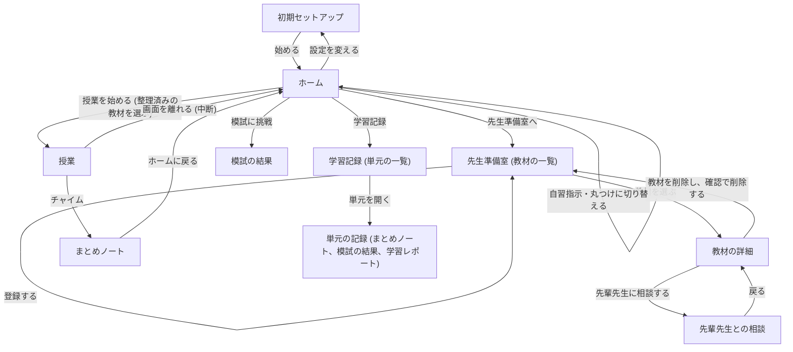
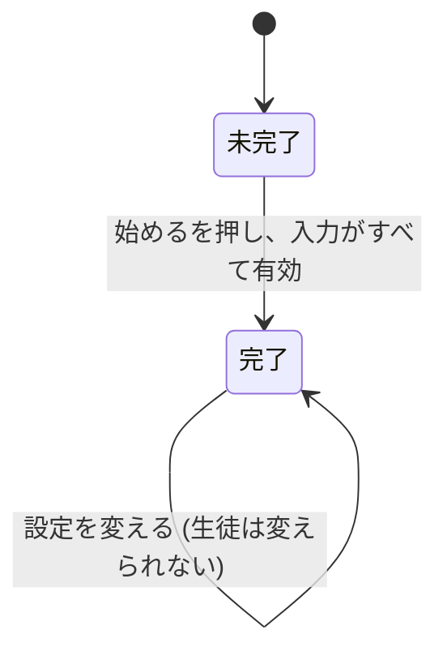
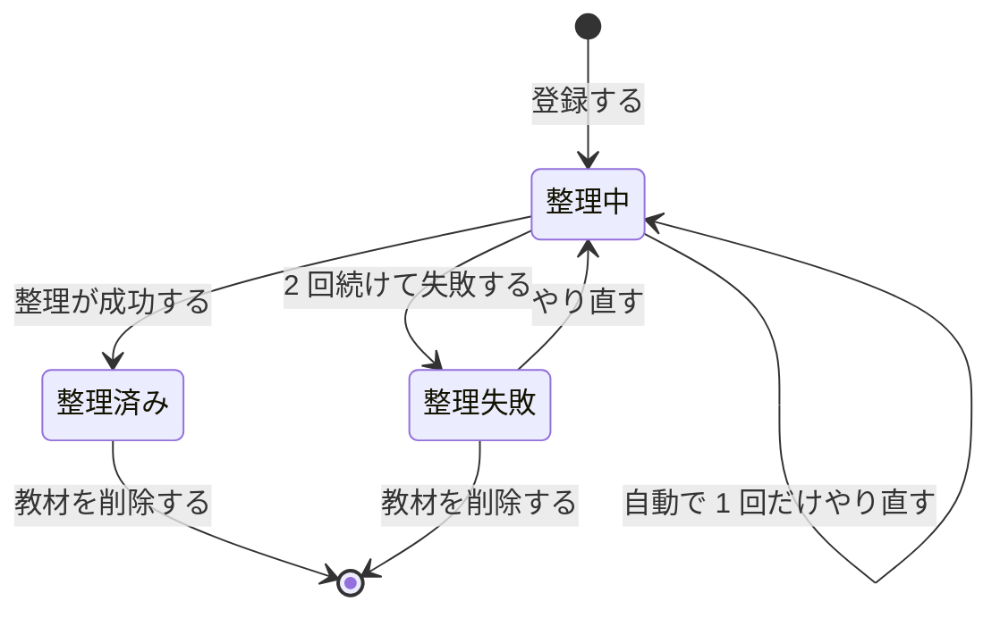
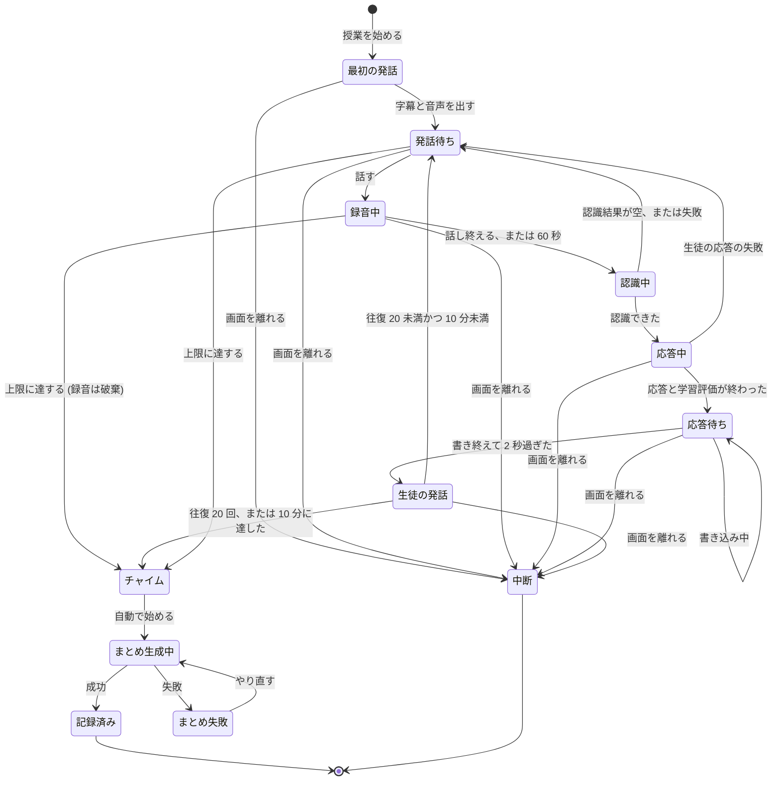
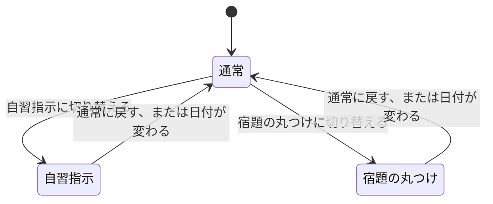
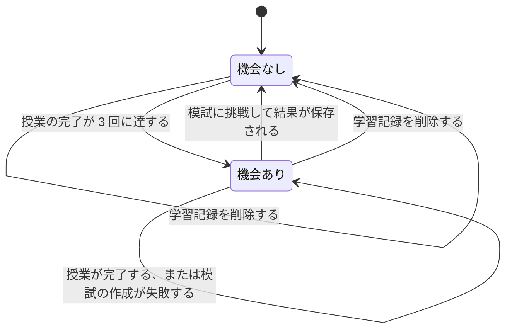

# 仕様書: AI 生徒育成型・対話学習サービスの MVP

- 機能の親 Issue: #1 AI 生徒育成型・対話学習サービスの MVP
- 段階の Issue: #3 仕様書
- 参考資料: `docs/features/1-ai-student-lesson/requirements.md` (要件定義書)、`docs/project.md` (プロジェクトの背景)

この文書は、要件定義書の各要件 (FR-*、NFR-*) を満たすサービスが、外から見てどう振る舞うかを定める。画面の見た目、技術の選択、データの持ち方は、後の段階で決める。

## 1. 概要

### 1.1 対象と前提

- 記録の持ち主は、ブラウザごとに分ける。アプリは、初めて開いたときにブラウザへ利用者の識別子を作り、教材と記録をその識別子に結びつけて保存する。同じブラウザで開き直すと、同じ記録を表示する。別のブラウザや別の端末からは、その記録は見えず、初期セットアップから始まる。要件定義書の「アカウントに紐づけて保存」は、この識別子への紐づけとして扱う。
- アカウントの登録とログイン、端末をまたいだ記録の共有は扱わない。要件に定めが無く、MVP の方針にも合わない。
- 利用する端末は、タブレット (横向き)、スタイラスペン、マイクとする。ブラウザで動く Web アプリケーションとする。
- 日付と週は日本時間で扱う。週は月曜の 0 時に始まり、日曜の 24 時に終わる。「今日」は 0 時から 24 時までとする。
- 授業と先生準備室の相談の時間は、開始の操作を起点に数える。時間は一時停止しない。
- 外部 AI サービスは次の 3 種類とする。
  - LLM: 文章と画像を受け取り、文章で応答するマルチモーダルな言語モデル。教材の整理、AI 生徒と先輩先生の応答、学習評価、まとめ、模試、宿題の丸つけに使う。
  - STT: 音声を文章にする音声認識。
  - TTS: 文章を音声にする音声合成。

### 1.2 用語

| 用語 | 意味 |
| --- | --- |
| 利用者 | このサービスを使う人。授業では「先生」になる |
| AI 生徒 | 利用者が教える相手の生徒。種類は 1.3 のとおり 3 つ。字幕の表示名は「生徒」とする |
| 先輩先生 | 利用者の予習を助ける AI のメンター |
| 教材 | 利用者が登録する問題集やプリントの写真 |
| 問題 | 教材から整理された 1 問。MVP では 1 つの教材を 1 問として扱う |
| 指導のポイント | 問題ごとに整理された、AI 生徒に伝えるべき重要ポイント。必ず 3 件 |
| 単元 | 教科ごとの学習の区切り。利用者が名前を入力する |
| 授業 | 1 つの問題を使い、AI 生徒に教える 1 回のまとまり |
| 往復 | 利用者の発話 1 回と、それに対する応答 1 回の組。授業の最初に AI 生徒が話す発話は数えない |
| 字幕 | 発話を画面に文字で表示したもの |
| 度合い | 指導のポイントが、利用者の発話で AI 生徒に伝わった程度。0、1、2 のいずれか (6.1) |
| 理解度 | 単元ごとの AI 生徒の理解の度合い (0 以上 100 以下)。内部の値で、画面には模試の得点としてのみ表示する |
| 今週の授業 | 今週に完了した授業の回数 |
| 今日のモード | 通常、自習指示、宿題の丸つけのいずれか。日付が変わると通常に戻る |
| 模試の機会 | 授業の回数が一定に達し、利用者が挑戦できる模試 |
| 中断 | 授業や相談が、上限に達する前に画面から離れられたこと。記録は残らない |

### 1.3 AI 生徒の種類

| 種類 (画面の表示名) | 初期偏差値 | 目標偏差値 | 性格 (応答の方針) |
| --- | --- | --- | --- |
| 直感・感覚派 | 45 | 50 | 難しい専門用語に弱く、図解や身近な具体例を求める |
| 真面目な暗記派 | 52 | 58 | 公式は覚えているが、なぜその解き方を使うのかという発想の過程を質問する |
| 論理・ツッコミ派 | 60 | 65 | 説明の飛躍や例外ケースについて、鋭く質問する |

要件定義書では「タイプ A / B / C」と呼んでいる。画面に出す表示名は、この文書で定める (要件定義書に名前の定めが無いため)。

目標偏差値は、FR-101 の「目標レベル」を、この文書で偏差値の値として定めたものである。画面に表示するだけで、理解度や模試の計算には使わない。値は暫定で、人が決めて直す。

## 2. 範囲の判断

### 2.1 判断の材料

- 方針 (`docs/project.md`): 優先順位は D (納期) > C (費用) > Q (品質)。品質の水準は MVP とし、受け入れテストでは、主要なユーザーフローの正常系と、API の無限ループや進行不能になる致命的な異常系だけを確かめる。エッジケースの網羅、過剰なパフォーマンス最適化、複雑な権限管理は行わない。
- 規模と期限: 利用者は数十人から 100 人規模。期限は 2026/10/30 23:59 まで。外部 AI サービスの費用は、暴走させないことを優先する。
- 機能の事情 (親 Issue #1 と要件定義書): MVP の検証は数学と理科の 2 教科に絞る。キャラクターメイキング、勉強以外の雑談、ユーザー間の交流、ストア配信はスコープ外。要件定義書 7.1 により、自動の受け入れテストは、画面遷移、画面に表示される内容、ユーザーと AI 生徒の対話の往復までを確かめる。

### 2.2 扱うこと、扱わないこと

扱うこと:

- 要件定義書の FR-101 から FR-104、FR-201 から FR-203、FR-301 から FR-305、FR-401 から FR-404 の振る舞い。FR-101 の目標偏差値は表示のみ
- NFR-201 (授業と相談の上限)、NFR-301 から NFR-304 (データの送信、保存、削除、共有)。NFR-301 は、写真と音声・字幕の注意と確認 (5.1、5.3、5.10) で扱う
- NFR-101 (対話のテンポ)、FR-302 のペンの割り込み防止と指し示し、FR-303 の表情の振る舞い。振る舞いは仕様で定めるが、受け入れテストでは確かめず、人が判断する

扱わないこと:

- 手書きのストロークそのもの、ペンの筆跡、ボードの描画の細部。受け入れテストでは確かめず、人が判断する
- 音声入力の品質、音声合成の自然さ、表情や声色の見た目、Live2D の描画。受け入れテストでは確かめず、人が判断する
- アカウントの登録とログイン、端末をまたぐ記録の共有、権限の区別。要件に定めが無く、MVP の方針にも合わない
- 写真や音声に含まれる個人情報を、アプリが自動で取り除くこと。MVP では、利用者が個人情報を写さず、話さず、書かないことを確認してから使う方式とする。写真は確認のチェックの後にだけ送り、音声と字幕とボードの内容は、初期セットアップの確認のチェックを入れた後に送る (5.1、5.10)。アプリは、氏名、学校名、連絡先を入力させず、取り除く処理もしない
- 5 教科以降への拡張、キャラクターメイキング、雑談、ユーザー間の交流、ストア配信 (スコープ外)
- 画面の見た目、技術の選択、データの持ち方 (後の段階で決める)
- 授業の字幕と先輩先生への相談の内容の保存。NFR-302 の保存対象に含まれないため、整理や記録が終われば残さない

未解決の矛盾 (要件定義書の修正が必要):

- NFR-301 は、氏名、学校名、連絡先を外部の AI サービスへ送らないことを求める。この仕様は、利用者が「話さず、書かず、写さない」ことを確認のチェックで約束する方式を取る。この方式では、アプリは送る前に個人情報を見分けず、取り除かない。音声は STT に送られ、字幕とボードの内容は LLM に送られるため、利用者が約束を破れば、個人情報は外部へ送られる。
- 送信前に除去する、または送信を止める手順は、この方式では定められない。その手順を定めるには、先に要件定義書の NFR-301 を、利用者の約束による扱いに改めるか、送信の手順を定める必要がある。要件定義書は、この段階の成果物の範囲に入らないため、この仕様では直さない。
- したがって、5.10 の方式は、要件定義書が改まるまでの暫定の扱いとする。要件定義書を直してから、この仕様の 2.2、3、5.10 を合わせて直す。

### 2.3 異常系と境界値の決め方

仕様では、異常系と境界値を、次の表のとおり決める。受け入れテストで確かめるのは、方針が名指しする「費用の暴走」と「進行の停止」に当たるものだけとする。

| 種類 | 仕様で決めること | 受け入れテストで確かめること | 理由 |
| --- | --- | --- | --- |
| 入力の誤り | 代表的な誤り (空、範囲外、形式違い) の表示と、保存しないこと (8 節) | 確かめない (単体テストに任せる) | 方針は正常系を中心とし、入力の誤りは進行を止めないため |
| 権限 | 利用者は 1 人のため、権限の判定は無い | 確かめない | 複雑な権限管理は行わない (方針) |
| 競合 | 同名の単元、応答中の発話、削除の二重押し (8 節) | 確かめない | 二重の AI 呼び出しを防ぐ決まりは仕様で定めるが、確かめる範囲は方針に合わせて絞る |
| 外部の失敗 | 失敗の表示と、先へ進める操作 (8 節) | 進行が止まらないことを確かめる。授業の応答、教材の整理、まとめの作成の 3 件 | 失敗で進行が止まるのは、方針が挙げる致命的な異常系に当たるため |
| 費用の暴走 | 回数と時間の上限、録音時間の上限、再試行の回数 (9 節) | 授業の 20 往復と 10 分、先輩先生との相談の 15 往復を確かめる | 方針が挙げる API の無限ループ (費用の暴走) に当たるため (NFR-201) |
| そのほかの境界値 | 上限と下限を 9 節に書く | 確かめない (単体テストに任せる) | 方針は、エッジケースの網羅を行わないため |

### 2.4 受け入れテストの前提

- 外部 AI サービス (LLM、STT、TTS) は、テストで決めた応答を返すフェイクに差し替えて起動できること。フェイクは、正常な応答と、失敗する応答の両方を返せること。LLM は、生徒の応答、学習評価、先輩先生の応答、整理、まとめ、模試、宿題の丸つけの呼び出しごとに、テストが決めた応答を返す。
- 受け入れテストでは、録音の代わりに、テストが決めた認識結果を使う。利用者は「話す」と「話し終える」のボタンを操作する。
- 教材の画像と宿題の写真は、テストが用意した画像ファイルを使う。写真の確認のチェックは、テストが入れる。初期セットアップの個人情報の確認のチェックも、テストが入れる。
- 授業と相談の 10 分の上限は、テストで実際に 10 分待つか、短い値に差し替えるかを後の段階で決める。この文書の値は 10 分とする。
- 週や日付の区切りをまたぐ操作は、受け入れテストでは行わない。

## 3. 要件との対応

| 要件 | 仕様の節 | 受け入れテストでの扱い |
| --- | --- | --- |
| FR-101 担当生徒の選択 | 1.3、5.1 初期セットアップ | 確かめる (選択肢の表示と、選んだ生徒の表示) |
| FR-102 担当教科・単元設定 | 5.1 初期セットアップ | 確かめる |
| FR-103 週間シフト設定 | 5.1 初期セットアップ、5.2 ホーム | 確かめる |
| FR-104 休講・自習モード | 5.2 ホーム | 確かめる |
| FR-201 教材の持ち込み | 5.3 教材の登録と整理 | 確かめる |
| FR-202 問題の清書と指導ポイントの整理 | 5.3 教材の登録と整理、6 節 | 確かめる |
| FR-203 先輩先生への質問・予習 | 5.4 先輩先生への相談 | 往復を確かめる。音声そのものは人が判断する。ボードの内容と指している範囲は、応答の材料として渡す |
| FR-301 ホワイトボードの初期配置 | 5.5 授業 | 確かめる |
| FR-302 描画と連携した音声対話 | 5.5 授業 | 往復を確かめる。書き込みの待ちと指し示しは人が判断する |
| FR-303 AI 生徒のリアクションと質問 | 5.5 授業 | 往復を確かめる。表情の変化は人が判断する |
| FR-304 チャイム制 | 5.5 授業、9 節 | 確かめる (20 往復と 10 分) |
| FR-305 まとめノートの作成 | 5.6 まとめノート | 確かめる |
| FR-401 理解度の蓄積 | 5.5、6 節、7 節 | 内部の値のため確かめない。模試の得点と偏差値の表示で間接的に確かめる |
| FR-402 模試イベント | 5.7 模試 | 確かめる |
| FR-403 模試結果・解答用紙の表示 | 5.7 模試 | 確かめる (得点、解答用紙、コメント、偏差値、偏差値の推移の表示) |
| FR-404 成長記録と学習レポートのシェア | 5.8 学習記録と画像の保存 | 確かめる (画像の保存と、学習レポートの内容) |
| NFR-101 待ち時間を感じさせないリアクション | 5.5 授業 | 人が判断する |
| NFR-201 時間・回数の上限 | 5.4、5.5 授業、9 節 | 確かめる |
| NFR-301 外部 AI サービスへの送信 | 5.1、5.3、5.10 送信と保存 | 確かめる (確認のチェックが無いと初期セットアップを保存できない。写真は確認のチェックの後にだけ送る)。「送信しない」の部分は 2.2 の未解決の矛盾があり、暫定の扱い |
| NFR-302 保存するデータ | 1.1、5.10 送信と保存 | 確かめる (開き直すと同じ記録が表示される) |
| NFR-303 削除 | 5.9 削除 | 確かめる |
| NFR-304 共有の範囲 | 5.8 学習記録と画像の保存 | 確かめない (画像の書き出しだけを行う) |
| 要件定義書 AC-1 | 5.3、5.4 | 確かめる (音声の対話そのものは人が判断する) |
| 要件定義書 AC-2 | 5.5 授業 | 人が判断する |
| 要件定義書 AC-3 | 5.5 授業、6 節 | 往復を確かめる。表情、声色、理解度の変化は人が判断する |
| 要件定義書 AC-4 | 5.6 まとめノート | 確かめる |
| 要件定義書 AC-5 | 5.7 模試 | 確かめる |
| 要件定義書 AC-6 | 5.5 授業、9 節 | 確かめる |
| 要件定義書 AC-7 | 5.1 初期セットアップ、5.2 ホーム | 確かめる |
| 要件定義書 AC-8 | 5.8 学習記録と画像の保存 | 確かめる |

## 4. 画面の遷移

## 5. 操作ごとの振る舞い

### 5.1 初期セットアップ

- 表示の条件: 利用者の設定が未完了のとき、アプリを開くと、この画面を表示する。
- 入力と有効な値:
  - 担当する生徒: 1.3 の 3 種類から 1 つ。必須。各選択肢に、表示名、初期偏差値、目標偏差値を表示する。
  - 教科: 「数学」か「理科」から 1 つ。必須。
  - 単元名: 前後の空白を除いて 1 文字以上 30 文字以内。必須。
  - 週の授業回数: 1 以上 7 以下の整数から 1 つ。必須。
  - 個人情報の確認: 「氏名、学校名、連絡先は話さず、ボードにも書かないことを確認しました」のチェックボックス。必須。チェックを入れるまで、保存できない。
- 操作「始める」:
  - すべての入力が有効で、個人情報の確認にチェックが入っているとき: 設定を保存し、設定を完了済みとする。ホーム (5.2) を表示する。今週の授業は 0 回とする。
  - 確認のチェックが無いとき: 「始める」を押せないようにする。何も保存しない。
  - 無効な入力があるとき: 何も保存しない。無効な項目の下にエラー文を表示し、画面はそのままにする。
- 単元名の扱い: 同じ教科の中に、前後の空白を除いて文字が完全に一致する単元名が既にあるときは、新しく作らず、その単元を使う。その単元の教材と記録はそのまま続く。
- 完了後の変更: ホームの「設定を変える」から、同じ画面を開ける。担当する生徒は表示のみとし、変えられない。教科、単元名、週の授業回数は変えられる。保存には、個人情報の確認のチェックが同じく要る。保存すると反映する。今週の授業の回数と、保存されている記録は変わらない。
- 単元を変えたとき: 先生準備室の教材、模試の機会、学習記録の表示は、新しく選んだ単元のものに切り替わる。前の単元の記録は残る。
- 開き直したとき: 設定が完了していれば、同じブラウザでアプリを開いたときに、この画面を出さずにホーム (5.2) を表示する (1.1)。

### 5.2 ホーム

- 表示:
  - 担当する生徒の表示名 (例: 「論理・ツッコミ派」)
  - 教科と単元名を「数学・二次関数」の形で
  - 今週の授業を「今週の授業 0 / 3 回」の形で
  - 模試の機会があるときは「模試に挑戦」
  - 今日のモード
  - 操作ボタン: 「授業を始める」「先生準備室へ」「学習記録」「設定を変える」
- 今日のモードの切り替え (FR-104): 切り替えは 1 回押すだけで、確認は出さない。
  - 通常のとき: 「自習指示に切り替える」「宿題の丸つけに切り替える」を表示する。
    - 「自習指示に切り替える」を押すと、今日のモードを自習指示にする。「今日は自習指示の日です」と「今日は「(単元名)」の教材から、問題を 1 つ解いてみてください。」を表示し、「授業を始める」は表示しない。
    - 「宿題の丸つけに切り替える」を押すと、今日のモードを宿題の丸つけにする。「今日は宿題の丸つけの日です」と「宿題の写真を登録」を表示し、「授業を始める」は表示しない。
  - 自習指示または宿題の丸つけのとき: 「通常に戻す」を表示する。押すと、今日のモードを通常に戻す。
  - 日付が変わると、今日のモードは通常に戻る。
- 宿題の丸つけ: 写真 1 枚 (JPEG か PNG、10 MB 以下) を選ぶ。写真を選ぶと、「写真に氏名、学校名、連絡先が写っていないことを確認しました」のチェックボックスを表示する。チェックを入れるまで、「判定する」は押せない。「判定する」を押すと、LLM が判定し、「判定」の欄に「正解」「不正解」「判定できませんでした。撮り直してください」のいずれかと、一言のコメントを表示する。写真が無効なときは、エラーを表示し、判定しない。判定の結果は保存しない。
- 自習指示と宿題の丸つけは、今週の授業の回数に数えない。
- 「授業を始める」は、今日のモードが通常のときに表示する。
- 「模試に挑戦」は、今日のモードに関係なく、模試の機会があるときに表示する。
- 「今週の授業」は、授業が 5.6 のまとめまで成功した回数のうち、今週の範囲に入るものを数える。

### 5.3 教材の登録と整理 (先生準備室)

- 入口: ホームの「先生準備室へ」。現在の単元の教材の一覧を表示する。教材は登録順に「教材 1」「教材 2」と番号を付けて表示する。教材がないときは「教材はまだありません」を表示する。
- 登録の入力: 画像 1 枚以上 3 枚以下。画像は JPEG か PNG で、1 枚 10 MB 以下とする。画像を選ぶと、5.2 と同じ「写真に氏名、学校名、連絡先が写っていないことを確認しました」のチェックボックスを表示する。
- 操作「登録する」: チェックを入れるまでは押せない。
  - 入力が有効なとき: 画像を外部の AI サービスへ送り、教材を 1 つ作り、状態を「整理中」にする。「整理しています」を表示し、整理を始める。
  - 入力が無効なとき: 何も保存せず、外部へも送らない。エラーを表示する。
- 整理 (LLM を使う): 教材の画像から、次の内容を作る。
  - 問題: 画面に読みやすく清書した問題文 (図表があれば図表を含む)
  - 模範解答と解説のステップ
  - 指導のポイント: 必ず 3 件
  - 生徒の途中の解答: 途中まで解いて手が止まっている状態
- 指導のポイントが 3 件ではないとき、または LLM の失敗があったときは、自動で 1 回だけ整理をやり直す。それでも成功しなければ、整理は失敗とする。
- 整理が成功したとき: 状態を「整理済み」にする。教材の詳細に「問題」「模範解答」「解説」「生徒の途中の解答」「指導のポイント」の見出しを表示する。各見出しの下に、整理の結果の内容を表示し、指導のポイントは 3 件の箇条書きで表示する。
- 整理が失敗したとき: 状態を「整理できませんでした」にする。「整理できませんでした」と「やり直す」を表示する。
- 「やり直す」: 押すと、状態を「整理中」にして、整理をもう一度始める。利用者が押した再試行の回数に上限は設けない。整理中は「やり直す」を表示しない。
- 整理中に画面を離れても、整理は続く。戻ると、結果を見られる。
- 教材の数に上限は設けない。
- 1 つの教材の詳細は、「先輩先生に相談する」(5.4) と「教材を削除」(5.9) を表示する。「先輩先生に相談する」は、整理済みの教材でだけ表示する。

### 5.4 先輩先生への相談 (先生準備室)

- 入口: 整理済みの教材の詳細の「先輩先生に相談する」。
- 画面: 問題文をボードに表示する。「話す」のボタンと、字幕の欄を置く。利用者はペンでボードに書ける。書いた内容は、相談の間だけボードに残し、保存しない。画面に「氏名、学校名、連絡先は話さないでください」を表示する。
- 操作「話す」: 録音を始める。ボタンは「話し終える」に変わる。
- 操作「話し終える」: 録音を終え、STT で文章にする。
  - 認識結果が空のとき: 「うまく聞き取れませんでした。もう一度話してください」を表示する。往復には数えない。
  - 認識できたとき: 字幕「あなた」に認識結果を表示する。続けて、先輩先生の応答を作る (LLM を 1 回呼び出す)。応答は字幕「先輩先生」で表示し、TTS で音声にする。
- 先輩先生の応答の材料: 問題、模範解答、解説、指導のポイント、利用者の発話、これまでの字幕、発話の時点のボードの内容 (画像)、指している範囲 (5.5 の「指している範囲」と同じ決め方)。先輩先生は教材の内容をすべて知っている。
- 先輩先生の応答には、ボードに書き込む図や式、ポイントを含めてよい。書き込みは、ボードに表示する。
- 応答の失敗: 「先輩先生の応答を作れませんでした。もう一度話してください」を表示する。「話す」は押せる状態に戻す。往復には数えない。
- 音声の生成に失敗したとき: 字幕だけで続ける。
- 1 往復は、利用者の発話 1 回と、先輩先生の応答 1 回の組とする。応答の字幕が表示されたときに、1 往復増える。
- 上限: 15 往復、または相談の開始から 10 分。どちらか早い方に達したら、区切る。
  - 応答の途中で達したときは、応答の字幕と音声が終わってから区切る。
  - 録音の途中で達したときは、録音を破棄する。
  - 区切るときは「相談の時間が終わりました」を表示し、「話す」は押せない状態にする。
- 相談の内容は保存しない。画面を離れると相談は終わり、中断として扱う。記録は残らない。

### 5.5 授業

#### 開始

- 入口: ホームの「授業を始める」。今日のモードが通常で、今の単元に整理済みの教材が 1 つ以上あるときに使える。
- 整理済みの教材がないとき: 「授業を始めるには、先生準備室で教材を登録してください」を表示する。授業は始まらない。
- 操作: 整理済みの教材を 1 つ選び、「授業を始める」を押す。
- 授業の画面には、「氏名、学校名、連絡先は話さないでください」を表示する。
- 処理:
  - 授業の開始時刻を記録する。
  - ボードに初期配置を置く (下の「ボードの初期配置」)。
  - AI 生徒が最初の発話をする。字幕「生徒」と音声で出す。最初の発話は往復に数えない。
- 最初の発話の材料は、問題文と「生徒の途中の解答」だけとする。

#### ボードの初期配置 (FR-301)

- 「問題」の見出しの下に、清書された問題文と図表を置く。
- 「生徒のノート」の見出しの下に、生徒の途中の解答を置く。
- 模範解答、解説、指導のポイントは、ボードに表示しない。AI 生徒は答えを知らない状態で話す。

#### 利用者の発話 (FR-302)

- 操作「話す」: 録音を始める。ボタンは「話し終える」に変わる。
- 操作「話し終える」、または録音が 60 秒に達したとき: 録音を終え、STT で文章にする。
- 認識結果が空のとき: 「うまく聞き取れませんでした。もう一度話してください」を表示する。往復には数えない。
- 認識できたとき: 字幕「あなた」に認識結果を表示し、下の「生徒の応答」を始める。
- 「指している範囲」: 録音を始めてから終えるまでと、録音を始める前の 10 秒の間にペンがボードに触れた範囲を、発話と一緒に AI 生徒へ伝える。ペンで触れていなければ、指している範囲は無いものとする。
- 録音中と応答中は、「話す」を押せない。

#### 生徒の応答 (FR-303、FR-401、NFR-101)

- 認識の結果を受けた直後に、相槌を 1 つ表示する。相槌は「えーっと…」「なるほど！」「ふむ…」のどれか 1 つとし、表情は「考え中」にする。相槌は字幕に残さず、往復にも数えない。
- 1 回の発話につき、LLM を 2 回呼び出す。2 つは並べて行い、両方が終わってから応答を表示する。
  1. 生徒の応答: AI 生徒の役として、次の 3 つを得る。
     - 応答の文章 (100 字以内を目安とする)
     - 表情: 「通常」「困り」「納得」のいずれか
     - ボード上で示す箇所、または「？」の印を書き込む箇所
     - 材料: 問題文、発話の時点のボードの内容、利用者の発話、これまでの字幕、指している範囲。模範解答、解説、指導のポイントは渡さない。AI 生徒は答えを知らないまま応答する。
  2. 学習評価: AI 生徒の応答には使わず、指導のポイント 3 件のそれぞれについて、度合い (6.1) を得る。
     - 材料: 指導のポイント 3 件、模範解答と解説 (指導のポイントの内容を判定するための参照)、問題文、発話の時点のボードの内容、利用者の発話、これまでの字幕、指している範囲。
     - 学習評価の結果は、利用者にも AI 生徒にも見せない。
- 両方が終わったら、応答を表示する。学習評価が失敗しても、応答は表示する。その発話の度合いは変えない (8 節)。
- 応答の表示:
  - 字幕「生徒」を出す。同時に、表情を変え、指す箇所や「？」の印を書き込む。
  - 音声を再生する。音声の生成に失敗したときは、字幕だけで続ける。
  - 応答の字幕が表示された時点で、往復が 1 つ増える。
  - 学習評価の結果を、その発話の度合いとして 6.1 のとおり反映する。
- 応答の失敗 (生徒の応答の呼び出しが失敗したとき): 「生徒の応答を作れませんでした。もう一度話してください」を表示する。「話す」は押せる状態に戻す。往復には数えない。その発話の学習評価の結果は、失敗と同じく使わない。理解度も変えない。利用者の発話の字幕は残す。

#### ペンの割り込み防止 (FR-302)

- ペンがボードに触れている間を「書き込み中」とする。ペンを離してから 2 秒間を「書き終えた直後」とする。
- 書き込み中と書き終えた直後は、AI 生徒は頷くだけにする (表情は「通常」)。字幕も音声も出さない。
- 応答の準備ができていても、書き込み中か、書き終えた直後の 2 秒の間は、字幕も音声も出さない。2 秒が過ぎてから出す。
- 書き込みが続く間は、いつまでも待つ。
- 利用者が書いただけで発話していないときは、AI 生徒は話し出さない。

#### 上限とチャイム (FR-304、NFR-201)

- 授業の上限は、開始から 10 分、または往復 20 回。どちらか早い方に達したら、チャイムを鳴らす。
- 達したときの振る舞い:
  - 発話待ちのとき: すぐにチャイムを鳴らす。
  - 録音中のとき: 録音を破棄して認識しない。チャイムを鳴らす。
  - 生徒の応答の途中のとき: 応答の字幕と音声が終わってから、チャイムを鳴らす。20 往復目の応答も同じ。
- チャイムは「チャイムが鳴りました。授業のまとめに入ります」と表示する。書き込み中でも表示するが、音声は出さない。
- チャイムの後は「話す」を押せない。まとめ (5.6) に進む。

#### 中断

- チャイムの前に利用者が授業の画面から離れたときは、授業を中断とする。
- 中断した授業は記録しない。往復、理解度、まとめ、今週の授業、模試の機会は変わらない。
- 次に授業を始めると、最初からになる。

### 5.6 まとめノート

- 入口: チャイムの後、自動で始める。
- 処理: LLM を 1 回呼び出し、次の 2 つを作る。
  - まとめ文: AI 生徒の言葉で、今日教わった内容を整理した文章 (300 字以内を目安とする)
  - 引用する板書: 利用者がボードに描いた図や式のうち、分かりやすかったもの。0 件以上
  - 材料は、この授業の字幕とボードの内容。
- 表示: 見出し「まとめノート」の下に小見出し「今日のまとめ」を置き、まとめ文を表示する。引用する板書があるときは「先生の図と式」の見出しの下に表示する。まとめ文は音声にしない。
- 成功したとき: 授業を 1 回として記録する。次の処理を行う。
  - 今週の授業を 1 増やす。
  - 理解度を更新する (6 節)。
  - 模試の機会を数える (5.7)。
  - まとめノートを学習記録に保存する。
  - 「画像を保存」(5.8) と「ホームに戻る」を表示する。
- 失敗したとき: 「まとめノートを作れませんでした」と「やり直す」を表示する。「やり直す」を押すと、まとめの作成をもう一度行う。失敗している間は、授業を記録しない。
- 成功する前に画面を離れた授業は、記録しない。

### 5.7 模試 (FR-402、FR-403)

- 模試の機会: 単元ごとに、前回の模試の後 (初めてのときは最初から) に、授業の完了が 3 回に達すると、模試の機会ができる。模試の機会ができたら、ホームに「模試に挑戦」を表示する。
- 模試の機会は、挑戦して結果が保存されるまで残る。
- 操作「模試に挑戦」:
  - 材料: 直近の授業で使った問題、その単元の指導のポイント 3 件、挑戦した時点の理解度 (6.4。得点になる)、AI 生徒の種類 (1.3 の性格)。
  - LLM を 1 回呼び出し、類題を 1 問作らせ、AI 生徒が解いた解答用紙と、生徒のコメントを作らせる。
  - 解答用紙とコメントは、得点に合わせて作る。得点と解答の水準は次のとおりとし、LLM への指示で守らせる。
    - 得点が 80 以上: 最後まで解き、大きな誤りは無い。
    - 得点が 50 以上 79 以下: 途中までは正しく解き、一部で誤る。
    - 得点が 49 以下: 途中で手が止まる。
  - コメントは、得点の水準に合わせる。解答用紙と食い違わないよう、直近の授業の度合いでは決めない。
    - 得点が 80 以上: 指導のポイント 3 件とも「解けた」内容にする。
    - 得点が 50 以上 79 以下: 少なくとも 1 件は「一部迷った」の内容を含め、「迷ってしまった」の内容は含めない。
    - 得点が 49 以下: 少なくとも 1 件は「迷ってしまった」の内容を含める。
  - 得点: 挑戦した時点の理解度 (6.4)。偏差値: 6.5 の式で求める。
  - 結果を保存する。保存したら、模試の機会は消え、模試の数え直しを始める。
- 表示 (「模試の結果」の画面):
  - 「得点」: 0 以上 100 以下の整数
  - 「偏差値」: 小数第 1 位まで
  - 「解答用紙」: AI 生徒が書いた解答
  - 「生徒のコメント」: 一言から数文のコメント
  - 「偏差値の推移」: その単元の模試結果を古い順に、日付と偏差値の一覧で表示する。模試が 1 回だけのときは、その 1 件を表示する。
- 失敗したとき: 「模試を作れませんでした」と「やり直す」を表示する。結果は保存せず、模試の機会は残す。
- 模試の結果は、学習記録 (5.8) に残る。

### 5.8 学習記録と画像の保存 (FR-404、NFR-304)

- 入口: ホームの「学習記録」。授業の記録か模試の結果のある単元を一覧にする。どちらもないときは「学習記録がありません」を表示する。
- 単元の画面: 次の 3 つを表示する。
  - 「まとめノート」: 一覧 (新しい順)。各項目から内容を見られる。
  - 「模試の結果」: 一覧 (新しい順)。各項目から内容を見られる。
  - 「学習レポート」
- 画像の保存: まとめノート、模試の結果、学習レポートの画面に「画像を保存」を置く。押すと、その画面の内容を PNG 形式の画像にして、ファイルとしてダウンロードする。画像にできないときは「画像を保存できませんでした」を表示する。
- シェア: 端末が共有に対応しているときは、「画像を保存」に加えて「共有する」を表示する。共有は、端末の共有の仕組みに画像を渡す。共有の確認は人が行う。
- 学習レポートの内容 (見出し「学習レポート」の下に、次の項目を並べる):
  - 「単元名: (単元名)」
  - 「授業の回数: (n) 回」 (単元の授業の完了数の合計)
  - 「教えた問題の数: (n) 問」 (単元で授業に使った教材の数。同じ教材の重複は 1 つと数える)
  - 「最新の模試: 得点 (n)、偏差値 (m)」。模試がないときは「まだ模試がありません」
  - 理解度は表示しない。
  - 授業が 0 回のときは「まだ授業がありません」を表示し、「画像を保存」は表示しない。
- 学習レポートの画像は、LLM を使わずに作る。
- URL の作成と、ほかの利用者への公開は行わない。画像の書き出しだけを行う。

### 5.9 削除 (NFR-303)

- 教材の削除: 教材の詳細の「教材を削除」を押すと、確認を出す。確認の文言は「この教材を削除しますか？」とし、「削除する」と「やめる」を置く。「削除する」を押すと、教材と、その整理の結果を消す。授業の記録 (まとめノート、模試の結果) は残す。
- 学習記録の削除: 単元の画面の「この単元の学習記録を削除」を押すと、確認を出す。確認の文言は「この単元の学習記録を削除しますか？」とし、「削除する」と「やめる」を置く。「削除する」を押すと、その単元の授業の記録、まとめノート、模試の結果、理解度、模試の機会の数えを消す。教材は残す。
- 削除は取り消せない。「やめる」を押したときは、何も変えない。
- 削除ボタンを続けて押しても、削除は 1 回だけ行い、確認は 1 つだけ出す。

### 5.10 送信と保存 (NFR-301、NFR-302)

- 外部 AI サービスへ送るもの: 教材の画像 (確認のチェックの後だけ)、授業のボードの内容 (画像) と相談のボードの内容 (画像)、利用者の音声 (STT に渡す録音)、授業と相談の字幕 (まとめや応答の材料として)、宿題の写真 (確認のチェックの後だけ)。
- 送るのは、その処理に必要なものだけとする。アプリは、氏名、学校名、連絡先を入力させず、取り除く処理もしない。この扱いは暫定であり、2.2 の未解決の矛盾 (要件定義書の NFR-301 の修正が必要) に従う。
- 写真に写る情報は、利用者が「写真に氏名、学校名、連絡先が写っていないことを確認しました」にチェックを入れるまで送らない。チェック後の写真は、そのまま送る。写真に写っている情報の判断は、利用者が行う。
- 音声、字幕、ボードの内容は、初期セットアップで「氏名、学校名、連絡先は話さず、ボードにも書かないことを確認しました」にチェックを入れた利用者の分だけ送る。利用者が話した内容と書いた内容は、アプリは確かめず、取り除かない。授業と相談の画面には、同じ注意を表示する (5.4、5.5)。
- 保存するもの: 教材 (画像と整理の結果)、まとめノート、模試の結果、理解度、授業の記録 (回数、今週の授業の数えを含む)、模試の機会の数え、記録の持ち主を示す利用者の識別子 (1.1)。
- 保存しないもの: 録音データ (認識が終われば残さない)、授業と相談の字幕 (まとめの後に残さない)、宿題の写真と判定の結果、学習評価の結果 (度合いの最大値だけを、授業の記録として残す)。
- ブラウザの保存データを消すと、利用者の識別子が無くなり、記録は見えなくなる。初期セットアップから始まる。

## 6. 理解度と模試の計算

この節の式は、要件定義書に換算の定めが無いため、仕様として置いた暫定の値である。人が決めて直す。

### 6.1 指導のポイントの度合い

- 発話ごとに、学習評価 (5.5) が、指導のポイント 3 件のそれぞれについて、それまでの利用者の発話 (字幕とボードの内容) で伝わった度合いを判定する。度合いは次のいずれか。
  - 0: 伝わらなかった
  - 1: 一部伝わった
  - 2: 分かりやすく伝わった
- 授業の中では、各ポイントの度合いは、それまでの判定の最大値を保つ。
- 学習評価が失敗したとき、その発話の度合いは変えない。

### 6.2 授業の得点

- 授業の得点は、3 件の度合いの合計とする。0 以上 6 以下の整数。
- 授業が成功して記録されたときの、3 件の度合いの最大値で計算する。

### 6.3 理解度の更新

- 授業が成功して記録されたときに、単元の理解度を次の式で更新する。
  - 理解度 = 100 と「前の理解度 + 授業の得点 × 5」のうち小さい方
- 理解度の初期値は 0 とし、単元ごとに持つ。

### 6.4 模試の得点

- 模試の得点は、挑戦した時点の理解度とする。0 以上 100 以下の整数。

### 6.5 偏差値

- 模試の偏差値は、次の式で求め、小数第 1 位で四捨五入する。
  - 偏差値 = 初期偏差値 + 理解度 ÷ 10
- 初期偏差値は、1.3 の種類ごとの値 (45、52、60) とする。

## 7. 状態の遷移

### 7.1 利用者の設定

### 7.2 教材

### 7.3 授業

### 7.4 今日のモード

### 7.5 模試の機会

## 8. 異常系の振る舞い

| 種類 | 場面 | 振る舞い | 記録と回数への影響 |
| --- | --- | --- | --- |
| 入力の誤り | 単元名が空、または 31 文字以上 | 保存しない。項目の下に「単元名は 1 文字以上 30 文字以内で入力してください」を表示する | なし |
| 入力の誤り | 教科、担当する生徒、週の授業回数が未選択 | 保存しない。項目の下にそれぞれのエラーを表示する (「生徒を 1 人選んでください」「教科を選んでください」「週の授業回数を選んでください」) | なし |
| 入力の誤り | 教材の画像が 0 枚または 4 枚以上、形式違い、10 MB 超 | 登録しない。「画像は 1 枚から 3 枚まで選んでください」か「画像は JPEG か PNG で、1 枚 10 MB 以下にしてください」を表示する | なし |
| 入力の誤り | 宿題の写真が形式違い、または 10 MB 超 | 判定しない。上と同じ文言を表示する | なし |
| 入力の誤り | 写真の確認のチェックが無い | 「登録する」と「判定する」を押せないようにする。写真は外部へ送らない | なし |
| 入力の誤り | 初期セットアップの個人情報の確認のチェックが無い | 「始める」を押せないようにする。設定は保存せず、音声や字幕や書き込みを外部へ送らない | なし |
| 入力の誤り | 認識結果が空 (無言、雑音のみ) | 「うまく聞き取れませんでした。もう一度話してください」を表示する。「話す」は押せる | 往復に数えない |
| 権限 | 利用者は 1 人のため、権限の判定は無い (記録の持ち主は 1.1 の識別子で区別する) | 該当なし | 該当なし |
| 競合 | 同じ教科に同名の単元がある | 新しく作らず、既存の単元を使う (5.1) | 既存の記録が続く |
| 競合 | 録音中または応答中に「話す」を押す | 押せないようにする (ボタンを無効にする) | 二重の AI 呼び出しをしない |
| 競合 | 削除ボタンを続けて押す | 削除は 1 回だけ行い、確認は 1 つだけ出す | 1 回分だけ消す |
| 競合 | 整理中に「やり直す」を押す | 整理中は「やり直す」を表示しない | 整理を二重に始めない |
| 外部の失敗 | 教材の整理 (LLM) の失敗 | 自動で 1 回だけやり直す。なお失敗なら「整理できませんでした」と「やり直す」を表示する | 教材は残り、整理は完了しない |
| 外部の失敗 | 生徒の応答 (LLM) の失敗 | 「生徒の応答を作れませんでした。もう一度話してください」を表示し、「話す」は押せる状態に戻す | 往復に数えない。その発話の度合いと理解度は変えない |
| 外部の失敗 | 学習評価 (LLM) の失敗 | 生徒の応答は表示し、続ける | 往復は 1 増える。その発話の度合いは変えない |
| 外部の失敗 | 先輩先生の応答 (LLM) の失敗 | 「先輩先生の応答を作れませんでした。もう一度話してください」を表示し、「話す」は押せる状態に戻す | 往復に数えない |
| 外部の失敗 | 音声認識 (STT) の失敗 | 「うまく聞き取れませんでした。もう一度話してください」を表示する | 往復に数えない |
| 外部の失敗 | 音声合成 (TTS) の失敗 | 音声は出さず、字幕だけで続ける | 往復の数えには影響しない |
| 外部の失敗 | まとめの作成 (LLM) の失敗 | 「まとめノートを作れませんでした」と「やり直す」を表示する | 授業を記録しない |
| 外部の失敗 | 模試の作成 (LLM) の失敗 | 「模試を作れませんでした」と「やり直す」を表示する | 結果を保存しない。模試の機会は残る |
| 外部の失敗 | 宿題の丸つけ (LLM) の失敗、または判定できない写真 | 「判定できませんでした。撮り直してください」を表示する | 保存しない |
| 外部の失敗 | 画像の保存の失敗 | 「画像を保存できませんでした」を表示する | なし |
| 中断 | 授業の途中 (チャイムの前) に画面を離れる | 授業を中断し、記録を残さない | 往復、理解度、今週の授業、模試の機会は変わらない |
| 中断 | 相談の途中に画面を離れる | 相談を中断し、内容を残さない | 記録はない |
| 記録の持ち主 | ブラウザの保存データを消す、または別のブラウザで開く | 記録は見えず、初期セットアップから始まる | 記録は残らない (別のブラウザからは見えない) |

## 9. 境界値

| 項目 | 下限 | 上限 | 上限または下限に達したときの振る舞い |
| --- | --- | --- | --- |
| 単元名 | 1 文字 (前後の空白を除く) | 30 文字 | 31 文字以上は保存しない (8 節) |
| 週の授業回数 | 1 回 | 7 回 | 0 回と 8 回は選べない |
| 教材の画像 | 1 枚 | 3 枚。1 枚 10 MB 以下、JPEG か PNG | 0 枚と 4 枚は登録しない |
| 宿題の写真 | 1 枚 | 1 枚。10 MB 以下、JPEG か PNG | 2 枚以上は選べない |
| 録音 | 認識結果が 1 文字以上あるとき有効 | 60 秒 | 60 秒に達したら録音を終え、認識にかける |
| 授業の時間 | 開始の操作 | 10 分 | 10 分に達したら、5.5 のとおりチャイムを鳴らす |
| 授業の往復 | 0 回 | 20 回 | 20 回目の応答の後にチャイムを鳴らす |
| 相談の時間 | 開始の操作 | 10 分 | 10 分に達したら、5.4 のとおり区切る |
| 相談の往復 | 0 回 | 15 回 | 15 回目の応答の後に区切る |
| 発話 1 回あたりの LLM の呼び出し | 2 回 (生徒の応答 1、学習評価 1) | 2 回 | 再試行はしない。失敗は 8 節のとおり、利用者が話し直す |
| 生徒の応答の長さ | 1 文字 | 100 字 (目安) | LLM への指示で目安を守らせる |
| まとめ文の長さ | 1 文字 | 300 字 (目安) | LLM への指示で目安を守らせる |
| 指導のポイント | 3 件 | 3 件 | 2 件以下と 4 件以上は整理をやり直す (自動で 1 回だけ) |
| 整理の試行 | 1 回 | 2 回 (自動のやり直しは 1 回だけ) | 2 回続けて失敗したら「整理できませんでした」 |
| 指導のポイントの度合い | 0 | 2 | 6.1 のとおり |
| 授業の得点 | 0 | 6 | 6.2 のとおり |
| 理解度 | 0 | 100 | 100 に達したら、それ以上は増えない |
| 模試の機会 | 授業の完了 3 回 | 授業の完了 3 回ごと (挑戦するまで残る) | 挑戦すると数え直す |
| 偏差値の表示 | 小数第 1 位 | 小数第 1 位 | 小数第 2 位以下は四捨五入する |
| ペンが離れてからの待ち | 0 秒 | 2 秒 | 2 秒が過ぎてから、字幕と音声を出す |
| 指している範囲 | 録音中に触れた範囲 | 録音の開始前 10 秒を含む | 10 秒より前にペンで触れた範囲は含めない |

## 10. 画面の文言

この表の文言は、受け入れテストの期待する結果と同じものを使う。`(...)` は、画面の値を入れる部分を表す。

| 場面 | 文言 |
| --- | --- |
| 初期セットアップ | 「担当する生徒を選んでください」(見出し)、「始める」、「氏名、学校名、連絡先は話さず、ボードにも書かないことを確認しました」 |
| 初期セットアップの生徒の選択肢 | 表示名、「初期偏差値 (n)」「目標偏差値 (n)」 |
| 初期セットアップのエラー | 「生徒を 1 人選んでください」「教科を選んでください」「単元名は 1 文字以上 30 文字以内で入力してください」「週の授業回数を選んでください」 |
| ホーム | 「今週の授業 (n) / (m) 回」、「授業を始める」「先生準備室へ」「学習記録」「設定を変える」「模試に挑戦」 |
| ホームのモード | 「自習指示に切り替える」「宿題の丸つけに切り替える」「通常に戻す」「今日は自習指示の日です」「今日は「(単元名)」の教材から、問題を 1 つ解いてみてください。」「今日は宿題の丸つけの日です」「宿題の写真を登録」「判定する」 |
| 写真の確認 | 「写真に氏名、学校名、連絡先が写っていないことを確認しました」 |
| 丸つけの結果 | 「判定」(見出し)、「正解」「不正解」「判定できませんでした。撮り直してください」 |
| 授業の案内 | 「授業を始めるには、先生準備室で教材を登録してください」 |
| 先生準備室 | 「先生準備室」(見出し)、「教材を登録」「登録する」、「教材 (番号)」、「教材はまだありません」 |
| 教材の状態 | 「整理中」「整理済み」「整理できませんでした」、「整理しています」 |
| 教材の再試行 | 「やり直す」 |
| 教材のエラー | 「画像は 1 枚から 3 枚まで選んでください」「画像は JPEG か PNG で、1 枚 10 MB 以下にしてください」 |
| 教材の詳細 | 「問題」「模範解答」「解説」「生徒の途中の解答」「指導のポイント」(見出し)、「先輩先生に相談する」「教材を削除」 |
| 削除の確認 | 「この教材を削除しますか？」「この単元の学習記録を削除しますか？」「削除する」「やめる」 |
| 先輩先生との相談 | 字幕の表示名「あなた」「先輩先生」、「話す」「話し終える」、「相談の時間が終わりました」、「氏名、学校名、連絡先は話さないでください」 |
| 相談と授業の共通エラー | 「うまく聞き取れませんでした。もう一度話してください」 |
| 相談の応答のエラー | 「先輩先生の応答を作れませんでした。もう一度話してください」 |
| 授業 | 「問題」「生徒のノート」(見出し)、字幕の表示名「あなた」「生徒」、「話す」「話し終える」、「氏名、学校名、連絡先は話さないでください」 |
| 授業の応答のエラー | 「生徒の応答を作れませんでした。もう一度話してください」 |
| チャイム | 「チャイムが鳴りました。授業のまとめに入ります」 |
| 相槌 | 「えーっと…」「なるほど！」「ふむ…」 |
| まとめノート | 「まとめノート」(見出し)、「今日のまとめ」「先生の図と式」(小見出し)、「画像を保存」「ホームに戻る」 |
| まとめノートのエラー | 「まとめノートを作れませんでした」「やり直す」 |
| 模試の結果 | 「模試の結果」(見出し)、「得点」「偏差値」「解答用紙」「生徒のコメント」「偏差値の推移」 |
| 模試のエラー | 「模試を作れませんでした」「やり直す」 |
| 学習記録 | 「学習記録」(見出し)、「学習記録がありません」 |
| 単元の記録 | 「まとめノート」「模試の結果」「学習レポート」(見出し)、「この単元の学習記録を削除」 |
| 学習レポート | 「単元名: (単元名)」「授業の回数: (n) 回」「教えた問題の数: (n) 問」「最新の模試: 得点 (n)、偏差値 (m)」「まだ模試がありません」「まだ授業がありません」 |
| 画像の保存 | 「画像を保存」「画像を保存できませんでした」「共有する」 |
